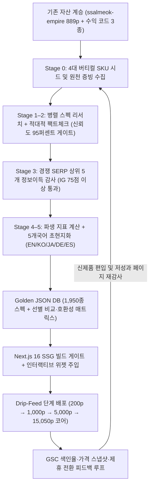

# SpecMatrix Global — 글로벌 실제품 스펙 검증 & 하이엔텐트 비교 매트릭스 공장

> **프로젝트 코드**: `specmatrix-global` (Project B — `ssalmeok-empire` 차세대 초확장 진화형)  
> **목표**: 20배 Ultra 요금제의 대규모 추론 토큰을 단순 블로그 글쓰기가 아닌 **실제품 스펙 전수 리서치 → 적대적 교차 팩트체크(Adversarial Fact-Checker) → 경쟁 SERP 대비 정보이득(Information Gain) 감사 → 5개국어(EN/KO/JA/DE/ES) 국가별 단위·전압·통화·제휴 리전 초현지화(Transcreation)**에 집중 투입하여, 기존 계산기 중심 SSG(`ssalmeok-empire`)를 **구매 직전(Bottom-of-Funnel) 실데이터 비교 매트릭스 공장**으로 도약시킨다.

---

## 1. 기존 운영 자산(`ssalmeok-empire`) 계승 및 진화 요약

`specmatrix-global`은 맨땅에서 시작하는 신규 사이트가 아니라, 이미 GitHub Pages(`https://kbu3986.github.io`)에서 가동 중인 **`ssalmeok-empire` (총 889 SSG 페이지, EN/KO)**와 **사전 연동 완료된 수익화 파이프라인**을 즉시 계승하여 고밀도 실데이터 공장으로 스케일업하는 프로젝트다.

### 기존 보유 자산 및 즉시 연동 수익화 코드

| 자산 구분 | 현재 운영 현황 (`ssalmeok-empire`) | `specmatrix-global` 계승 및 확장 방향 |
| :--- | :--- | :--- |
| **호스팅 및 허브** | `site0-hub` (`https://kbu3986.github.io`, 통합 사이트맵 인덱스) | 1단계 파일럿 트래픽 브리지로 활용 후, 독립 커스텀 도메인 클러스터로 단계적 분리 |
| **1호기 WattCheck** | 201 SSG 페이지 (항공사 기내 배터리 규정 + 범용 mAh·디바이스) | **버티컬 1 초확장**: 글로벌 보조배터리·GaN 충전기·파워뱅크 실제품 500종 × 100개 항공사 규정 + USB-PD 포트 분배 매트릭스 |
| **2호기 WorthMove** | 336 SSG 페이지 (이직 연봉·통근 손익 계산기, EN/KO) | 독립 고단가 금융·커리어 애드센스 자산으로 유지하며 허브 교차 유입 연계 |
| **3호기 PureGram** | 352 SSG 페이지 (48종 제품 × 6카테고리, 114쌍 1:1 비교, 가격 스냅샷 스크립트 보유) | **버티컬 2 초확장**: 글로벌 프로틴·크레아틴·전해질·에너지젤 실제품 600종 영양성분표 파싱 + 순수 유효성분 1 g당 실단가 랭킹 |
| **신규 고단가 버티컬** | 미보유 | **버티컬 3 (CycleGear Matrix)** 450종 + **버티컬 4 (HomeTech TCO Matrix)** 400종 신규 구축 |
| **수익화 코드 (연동 완료)** | 구글 애드센스 `ca-pub-8587506565277191`, 쿠팡 파트너스 `AF2200875` (Sub ID `ssalmeok-kr`), 아마존 어소시에이트 US `kbu3986-20`, GSC·네이버 인증 및 `deploy-ops` 원클릭 배포 제어탑 | Day 1 즉시 상속 + Amazon OneLink(JP/DE/ES/UK), AliExpress Portals, Rakuten, iHerb 글로벌 제휴 확장 |

---

## 2. 왜 SpecMatrix Global인가: 4대 핵심 해자

1. **초고토큰 실데이터 진입장벽** – 제품 1종당 평균 20만 토큰(리서치 + 적대적 교차검증)을 투입해 공식 매뉴얼·영양성분표·인증 DB·항공사 PDF 원문에서 출처가 고정된(Evidence-Anchored) 스펙 DB(1차 1,950종)를 구축한다. 1회성 프롬프트로 찍어낸 저품질 리뷰 사이트는 데이터 정확도와 파생 계산 지표에서 경쟁 자체가 불가능하다.
2. **구매 직전 하이엔텐트 쿼리 장악** – `"보조배터리 기내 반입"` 같은 범용 정보 키워드를 넘어, `"Anker Prime 27650 vs Shargeek 170 airline carry-on"`, `"Favero Assioma Duo vs Garmin Rally RS200"`, `"Synology DS923+ vs UGREEN DXP4800 3-year electricity cost"`처럼 결제 버튼을 누르기 직전의 고전환 비교·호환성 검색을 정조준한다.
3. **5개국어 국가별 초현지화(Transcreation)** – EN/KO/JA/DE/ES 단순 번역이 아니라, 전압(100 V / 120 V / 220 V / 230 V), 플러그 규격(Type A/B/C/F), 가정용 전기요금 단가(독일 €0.38/kWh 등), 단위계(oz·lb ↔ g·kg, psi ↔ bar), 현지 항공·안전 인증(FAA·MOLIT·MLIT·EASA / UL·KC·PSE·CE) 및 리전별 제휴 링크를 코드와 에이전트가 정밀 치환한다.
4. **구글 정보이득(Information Gain) & Drip-Feed 방어 내재화** – 모든 페이지는 경쟁 상위 5개 SERP를 사전 감사해 고유 파생 지표 3개 이상과 인터랙티브 계산기·필터를 의무 탑재하며, 1주차 200페이지 → 2주차 1,000페이지 → 4주차 5,000페이지 단계 배포로 Scaled Content Abuse 및 색인 블로트를 원천 방어한다.

---

## 3. 4대 고수익 버티컬 포트폴리오 개요

| 버티컬 | 코드명 | 1차 목표 실제품 수 | 핵심 비교·계산 축 (고유 정보이득) | 주요 수익 구조 |
| :--- | :--- | :--- | :--- | :--- |
| **버티컬 1** | **WattCheck Matrix** | 500종 (보조배터리·GaN·파워뱅크) | 100개 항공사 기내 반입 판정 + 멀티포트 동시 충전 시 실제 W 분배 + 변환효율 반영 실가용 Wh | 아마존·쿠팡 고빈도 제휴 + 여행·테크 애드센스 |
| **버티컬 2** | **PureGram Matrix** | 600종 (프로틴·크레아틴·전해질·에너지젤) | 영양성분표 교차 파싱 + 순수 유효성분 1 g당 실시간 단가 + 감미료·알레르겐·아미노 프로필 비교 | 쿠팡·아마존·iHerb 반복 재구매 제휴 + 헬스 애드센스 |
| **버티컬 3** | **CycleGear Matrix** | 450종 (파워미터·사이클링 컴퓨터·트레이너·타이어·Di2/AXS) | 객단가 20만–200만 원 고단가 부품 호환성(BB·프리허브·ANT+/BLE) + 구름저항(W)·정확도 비교 | 고객단가 제휴 커미션 + 고 CPC 아웃도어·스포츠 광고 |
| **버티컬 4** | **HomeTech TCO Matrix** | 400종 (MiniPC·NAS·UPS·로봇청소기) | 아이들·부하 소비전력(W) + 국가별 전기요금 기준 3년 TCO + 소음(dBA) + 소모품 유지비 비교 | 아마존(US/DE/JP/ES)·쿠팡·알리익스프레스 고단가 제휴 |
| **합계** | **4대 통합 매트릭스** | **1,950종 (1차 시드)** | **1차 코어 15,050p (풀 확장 상한 29,550p · 5개국어)** | **애드센스 + 다중 리전 제휴 복합 수익화** |

---

## 4. 디렉토리 구조 (기획 5대 문서 및 실행 아키텍처)

```text
specmatrix-global/
├── README.md                              # 프로젝트 개요, 기존 자산 계승 요약, 4단계 실행 로드맵
├── docs/
│   ├── 01-MASTER-PLAN.md                  # 마스터 기획서 (전환 전략, 5개국어 초현지화, IA·UX, 정보이득 원칙)
│   ├── 02-TOKEN-BURN-PIPELINE.md          # 6단계 고토큰 멀티에이전트 리서치·교차검증·현지화 파이프라인
│   ├── 03-VERTICAL-ROADMAP.md             # 4대 버티컬 상세 로드맵, JSON 스키마 샘플, 페이지 확장 공식
│   ├── 04-MONETIZATION-AND-OPS.md         # 수익화 코드 연동, 글로벌 제휴, 스냅샷 가격 갱신, Drip-Feed SEO 운영
│   └── 05-RISK-AND-KPI-AUDIT.md           # 기획 교차 감사, 월별 수익 시뮬레이션, Kill/Pivot KPI 및 실행 체크리스트
├── data/                                  # (Phase 1 생성) 버티컬별 Golden JSON DB, SERP 감사 로그, 가격 스냅샷
│   ├── wattcheck/
│   ├── puregram/
│   ├── cyclegear/
│   └── hometech/
├── pipeline/                              # (Phase 1 생성) 6단계 토큰 소모 오케스트레이터, 물리검증기, 현지화 QA
├── web/                                   # (Phase 2 생성) Next.js 16 SSG 통합 매트릭스 앱 + 인터랙티브 계산기
└── ops/                                   # (Phase 2 생성) Drip-Feed 배포, 죽은 링크 대체, GSC 색인율 모니터링
```

---

## 5. 전체 시스템 흐름도



---

## 6. 4단계 실행 로드맵 및 토큰 투입 규모

| 단계 | 기간 (목표) | 핵심 마일스톤 및 산출물 | 누적 실제품 / 배포 페이지 | 예상 토큰 투입량 |
| :--- | :--- | :--- | :--- | :--- |
| **Phase 0 (완료)** | Day 1 | 프로젝트 구조 수립 및 핵심 기획·감사 문서 5종(`01`–`05`) 완성 | 기획 완료 | 기획 설계 |
| **Phase 1 (파일럿 공장 가동)** | 1–2주차 | 6단계 파이프라인 구축 + WattCheck·PureGram 앵커 100종(+30항공사) 검증 + 200p → 1,000p Drip-Feed 배포 | 100종 / 200–1,000페이지 | 약 4,000만 토큰 |
| **Phase 2 (1–2차 확장 + CycleGear 진입)** | 3–4주차 | WattCheck 250종·PureGram 300종·CycleGear 앵커 80종 확보 + 커스텀 도메인 연동 및 5,000p 게이트 검증 | 630종 / 5,000페이지 | 약 1억 9,000만 토큰 |
| **Phase 3 (4대 버티컬 1차 코어 완공)** | 5–12주차 | CycleGear 450종 + HomeTech 400종 포함 4대 버티컬 1,950종 완성 + 5개국어 1차 코어 15,050p 안착 | 1,950종 / 15,050페이지 | 약 4억 4,000만 토큰 |
| **Phase 4 (풀 확장 및 자동 운영 루프)** | 4개월차 이후 | 고전환 VS 확장(상한 29,550p · 추가 약 2억 7,500만 토큰), 주간 가격 스냅샷 갱신, 월 80–120종 신제품 편입 | 최대 29,550페이지 + 지속 확장 | 월 6,000만–9,000만 토큰 |
| **1차 코어 완공 누계 (Phase 1–3)** | **12주 기준** | **4대 버티컬 1,950종 Golden DB + 5개국어 1차 코어 15,050 SSG 페이지** | **1,950종 / 15,050페이지** | **약 6억 7,000만 토큰** |

---

## 7. 포트폴리오 역할 분담: Project A vs Project B

| 비교 항목 | Project A (`pin2pin-global`) | Project B (`specmatrix-global`) |
| :--- | :--- | :--- |
| **타깃 시장** | B2B 하드웨어 엔지니어·전자부품 BOM 구매자 | B2C 구매 직전 하이엔텐트 글로벌 소비자 (테크·피트니스·로드사이클·홈테크) |
| **핵심 원천 데이터** | 반도체 제조사 공식 PDF 데이터시트·핀아웃 도면 | 소비재 공식 스펙시트·매뉴얼·영양성분표·항공사 규정 PDF·전기요금·인증 DB |
| **수익화 속도** | 중장기 고단가 B2B 애드센스 CPC + BOM Micro-SaaS | **초고속 수익화** (기존 `ssalmeok-empire` 애드센스·쿠팡·아마존 코드 즉시 연동) |
| **핵심 수익 엔진** | 초고단가 B2B 광고 클릭 + 유료 SaaS 구독 | 고전환 제휴 커미션(객단가 3만–200만 원) + 글로벌 5개국어 애드센스 RPM |
| **도메인·트래픽 간섭** | 완전 독립 (중복 키워드 0퍼센트) | 완전 독립 (기존 `ssalmeok-empire` 자산을 흡수·고도화) |
