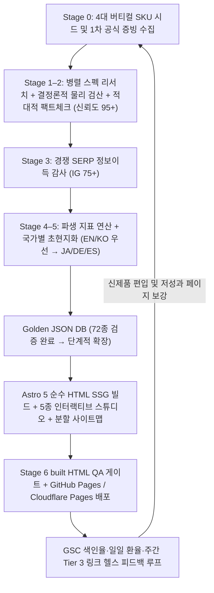

# SpecMatrix Global — 글로벌 실제품 스펙 검증 & 하이엔텐트 비교 매트릭스 공장

> **프로젝트 코드**: `specmatrix-global`  
> **현재 프로덕션 현황 (v2)**: Astro 5 순수 HTML SSG · **4대 버티컬 · 72종 검증 SKU · 31쌍 에디토리얼 1:1 VS · 13종 매트릭스/호환표 · 5종 인터랙티브 스튜디오 · 30개 글로벌 항공사 DB** (EN/KO)  
> **목표**: 대규모 추론 파이프라인을 단순 블로그 글쓰기가 아닌 **실제품 스펙 전수 리서치 → 적대적 교차 팩트체크(Adversarial Fact-Checker) → 경쟁 SERP 대비 정보이득(Information Gain) 감사 → 다국어 국가별 단위·전압·통화·제휴 리전 초현지화(Transcreation)**에 집중 투입하여, **구매 직전(Bottom-of-Funnel) 실데이터 비교 매트릭스 공장**으로 확장한다.

---

## 1. 현재 구현 스택 및 수익화·운영 현황

`specmatrix-global`은 Node.js ESM 데이터 검증 파이프라인(`pipeline/`, Zod v3)과 **Astro 5 순수 HTML SSG(`web/`, Tailwind CSS v4, TypeScript)** 기반의 독립 정적 웹 애플리케이션이다.

### 핵심 구성 및 수익화 정책

| 구분 | 현재 운영 현황 (`specmatrix-global` v2) | 확장 로드맵 |
| :--- | :--- | :--- |
| **웹 엔진 & 호스팅** | **Astro 5 순수 HTML SSG** (GitHub Pages 프로덕션 배포 · Cloudflare Pages 무코드 전환 지원) | 단일 페이지당 1 HTML 파일 구조로 20,000파일 정적 상한 내 안정 확장 |
| **버티컬 1 (WattCheck)** | 검증된 보조배터리·GaN 충전기·파워스테이션 SKU + 30개 글로벌 항공사 기내 규정 + 여행 전력 키트 최적화기 | 1차 500종 × 100개 항공사 규정 확장 |
| **버티컬 2 (PureGram)** | 검증된 에너지젤·카보믹스·전해질·크레아틴 SKU + 레이스 보급 믹스 플래너 (영양성분표 기반 객관적 팩트 연산) | 1차 600종 영양성분표 교차 파싱 확장 |
| **버티컬 3 (CycleGear)** | 검증된 파워미터·GPS 컴퓨터·스마트 트레이너·로드 타이어·구동계 + 타이어 공기압 & 후크리스 5.0 bar 안전 가드 | 1차 450종 호환성 그래프 확장 |
| **버티컬 4 (HomeTech)** | 검증된 미니PC·NAS·UPS·로봇청소기 + 3년 TCO 손익분기 & 멀티기기 UPS 런타임 스튜디오 | 1차 400종 국가별 전기요금 TCO 확장 |
| **인터랙티브 스튜디오 (5종)** | ① 1:1 자유 비교 워크벤치 ② 여행 전력 키트 최적화기 ③ 레이스 보급 믹스 플래너 ④ HomeTech 3년 TCO & UPS 스튜디오 ⑤ 로드 타이어 공기압 & 후크리스 5.0 bar 안전 가드 | 전 버티컬 결정론적 0ms 클라이언트 시뮬레이션 |
| **수익화 코드 및 절대 정책** | Google AdSense `ca-pub-8587506565277191`, Coupang Partners `AF2200875` (`sm-*-kr`), Amazon Associates US `kbu3986-20` (`msrp_benchmark_mode`) · **iHerb 제휴·구매 링크 영구 금지** | 트래픽 연동 단계적 리전 확장(Amazon OneLink JP/DE/ES/UK, AliExpress Portals, Awin, Impact) |

---

## 2. 왜 SpecMatrix Global인가: 4대 핵심 해자

1. **증빙 고정(Evidence-Anchored) 실데이터 진입장벽** – 공식 매뉴얼·영양성분표·인증 DB·항공사 PDF 원문에서 출처가 고정된 스펙 DB를 적대적 팩트체크(신뢰도 95점 이상 게이트)로 검증한다.
2. **구매 직전 하이엔텐트 쿼리 장악** – `"Anker Prime 27650 vs Shargeek 170 airline carry-on"`, `"Favero Assioma PRO RS-2 vs Garmin Rally RS200"`, `"Apple Mac mini M4 vs Beelink SER8 3-year electricity cost"`처럼 결제 직전의 고전환 비교·호환성 검색을 정조준한다.
3. **국가별 물리 환경 초현지화(Transcreation)** – 단순 번역이 아니라 전압(100 V / 120 V / 220 V / 230 V), 플러그 규격(Type A/B/C/F), 가정용 전기요금 단가(한전 누진 1–3구간·미국 $0.17·독일 €0.38·일본 ¥31/kWh), 단위계(psi ↔ bar, g/kg), 현지 안전 인증(UL·KC·PSE·CE) 및 리전별 제휴 링크를 정밀 적용한다.
4. **구글 정보이득(Information Gain) & Drip-Feed 방어 내재화** – 모든 페이지는 고유 파생 지표와 인터랙티브 계산기·필터를 탑재하며, 단계별 Drip-Feed 배포와 분할 사이트맵으로 Scaled Content Abuse 및 색인 블로트를 원천 방어한다.

---

## 3. 4대 고수익 버티컬 포트폴리오 개요

| 버티컬 | 코드명 | 현재 v2 / 장기 목표 SKU | 핵심 비교·계산 축 (고유 정보이득) | 주요 수익 구조 (iHerb 영구 미사용) |
| :--- | :--- | :--- | :--- | :--- |
| **버티컬 1** | **WattCheck Matrix** | 25종 / 500종 (+30→100항공사) | 항공사 기내 반입 판정 + 멀티포트 동시 출력 분배 + 변환효율 반영 실가용 Wh | 아마존·쿠팡 제휴 + 여행·테크 애드센스 |
| **버티컬 2** | **PureGram Matrix** | 20종 / 600종 | 영양성분표 교차 파싱 + 순수 유효성분 기준 단가 + 1:0.8 비율·카페인·나트륨 레이스 설계 | 쿠팡·아마존 반복 재구매 제휴 + 애드센스 (**iHerb 금지**) |
| **버티컬 3** | **CycleGear Matrix** | 15종 / 450종 | 객단가 20만–200만 원 부품 호환성(BB·프리허브·ANT+/BLE) + ETRTO 후크리스 5.0 bar 안전 가드 | 고객단가 제휴 커미션(Amazon·Awin·Impact·쿠팡) + 고 CPC 광고 |
| **버티컬 4** | **HomeTech TCO Matrix** | 12종 / 400종 | 대기·부하 소비전력(W) + 국가별 전기요금 3년 TCO 손익분기 + 120V/220V UPS 런타임 | 아마존·쿠팡·직영몰 고단가 제휴 + IT 애드센스 |
| **합계** | **4대 통합 매트릭스** | **72종 검증 완료 (31 VS · 13 매트릭스 · 5 스튜디오)** | **단계별 코어 확장 (EN/KO → JA/DE/ES)** | **애드센스 + 다중 리전 제휴 복합 수익화** |

---

## 4. 디렉토리 구조

```text
specmatrix-global/
├── README.md                              # 프로젝트 개요, 아키텍처, 실행 명령어 및 로드맵
├── AGENTS.md                              # 단일 정본(SSOT) 엔지니어링·컴플라이언스 지시서
├── config/                                # 수익화 설정(v2) 및 공식 쿠팡 단축링크 레지스트리
├── schemas/                               # Zod v3 엄격 스키마 및 TypeScript SSOT 타입
├── data/                                  # 4대 버티컬 검증 완료 Golden JSON DB (72 SKUs, 31 VS, 13 Matrices)
│   ├── wattcheck/
│   ├── puregram/
│   ├── cyclegear/
│   ├── hometech/
│   └── snapshots/                         # 일일 환율(FX) 스냅샷
├── pipeline/                              # 데이터 검증, SERP IG 감사, 환율, 링크 헬스, Stage 6 HTML QA, 단위 테스트
├── web/                                   # Astro 5 순수 HTML SSG + Tailwind CSS v4 + 5종 인터랙티브 스튜디오
├── ops/                                   # GitHub Pages 배포 스크립트, CI 워크플로우, 로컬 전용 런치패드
└── docs/                                  # 마스터 기획·파이프라인·버티컬·수익화·리스크 감사 문서 (01–05)
```

---

## 5. 전체 시스템 흐름도



---

## 6. 필수 개발 및 검증 명령어

```bash
npm run validate         # Golden JSON 스키마 + 물리 불변식 + 서킷브레이커 검증
npm run test:pipeline    # 파이프라인 단위 테스트 실행
npm run audit:ig         # SERP 정보이득(Information Gain) 감사
npm run web:build        # OG 이미지 생성 → Astro 5 SSG 빌드 → 검색 인덱스 → 분할 사이트맵
npm run qa:stage6        # Stage 6 정적 HTML·링크·SEO·AdSense 안전 QA 게이트
npm run build:all        # validate + test:pipeline + web:build + qa:stage6 통합 실행
npm run health:links     # 외부 인용·항공사·제휴 링크 헬스 체크
npm run deploy:gh-pages  # GitHub Pages 프로덕션 배포 및 직통 HTTP 200 / 404 검증
```
