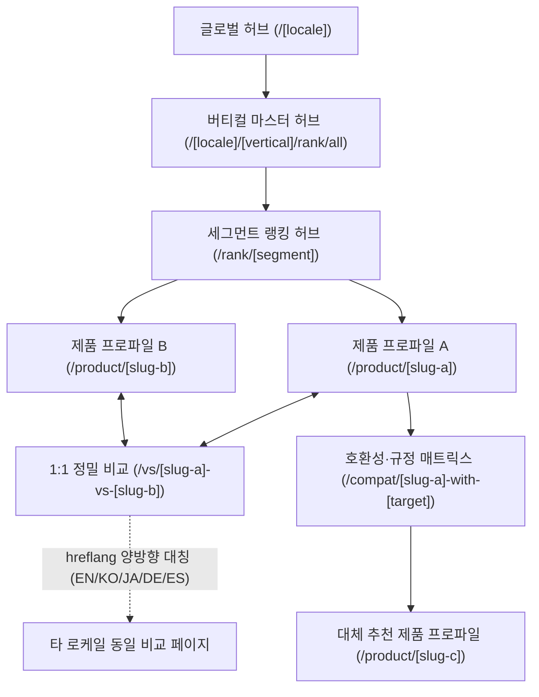

# 01. Master Plan — SpecMatrix Global

## 1. 전략적 전환 배경: 계산기 사이트(`ssalmeok-empire`)에서 실데이터 비교 공장(`specmatrix-global`)으로

기존 운영 중인 `ssalmeok-empire`는 단기간에 **889개 Next.js SSG 페이지**와 **원클릭 수익화 제어탑(`deploy-ops`)**을 실전 배치하며 기술적·운영적 검증을 마쳤다. 그러나 현재 구조에는 수익 상한선을 가로막는 4가지 구조적 한계가 존재한다.

1. **정보 탐색형 쿼리 편중** – 1호기 WattCheck(201페이지)는 `"20,000 mAh 대한항공 기내 반입"` 같은 일반 규정 계산에 강하지만, 사용자가 실제 결제 직전에 검색하는 `"Anker Prime 27650mAh 250W 기내 반입 가능 여부"` 또는 `"Anker 737 vs Ugreen Nexode 25000 맥북 동시 충전"` 같은 **모델명 기반 하이엔텐트 쿼리**를 포착하지 못한다.
2. **제한된 제품 커버리지** – 3호기 PureGram(352페이지)은 6개 카테고리 48개 대표 제품(114쌍 1:1 비교)으로 구조적 완성도는 높지만, 글로벌 시장의 롱테일 제품군(크레아틴·전해질·사이클링 에너지젤·지역 인기 보충제 600종 이상)을 감당하려면 수작업 TypeScript 하드코딩이 아닌 **자동 검증 데이터 공장**이 필요하다.
3. **2개국어(EN/KO) 한계와 고수익 언어권 미개척** – 일본(JA), 독일·DACH(DE), 스페인·중남미(ES)는 소비재 스펙 비교 검색량과 아마존 제휴 전환율이 매우 높은 반면, 영어권 대비 고품질 비교 매트릭스 경쟁 강도가 낮아 **선점 효과**가 극대화되는 시장이다.
4. **고객단가 버티컬 부재** – 보조배터리·보충제는 재구매율과 트래픽 볼륨이 우수하지만 객단가가 3만–15만 원 구간에 머문다. 로드사이클(파워미터·사이클링 컴퓨터·스마트 트레이너·구동계, 객단가 20만–200만 원)과 홈테크(MiniPC·NAS·UPS·로봇청소기, 객단가 30만–180만 원)를 결합하면 **건당 제휴 수익과 광고 RPM을 동시에 끌어올릴 수 있다**.

### v1 (`ssalmeok-empire`) vs v2 (`specmatrix-global`) 전략 비교

| 비교 차원 | v1: `ssalmeok-empire` (현재 운영) | v2: `specmatrix-global` (목표 시스템) |
| :--- | :--- | :--- |
| **핵심 콘텐츠 단위** | 범용 공식 계산기 + 소규모 큐레이션 목록 | **실제품 모델명(SKU) 기반 정밀 스펙 DB + 1:1 비교 + 호환성 매트릭스** |
| **검색 의도 단계** | Top / Mid-of-Funnel (규정 확인, 개념 계산) | **Bottom-of-Funnel (구매 직전 최종 모델 선정 및 호환성 검증)** |
| **데이터 구축 방식** | 소수 모델 수동 TypeScript 작성 | **6단계 고토큰 멀티에이전트 리서치 + 적대적 교차 팩트체크 자동화** |
| **언어 및 리전** | 2개국어 (EN / KO) | **5개국어 초현지화 (EN / KO / JA / DE / ES)** |
| **타깃 제품 및 페이지** | 48종 실제품 중심 / 총 889 SSG 페이지 | **1차 1,950종 실제품 / 1차 코어 15,050p (상한 29,550p · Drip-Feed 배포)** |
| **수익화 파이프라인** | 애드센스 + 쿠팡 + 아마존 US | 기존 3종 즉시 상속 + **Amazon OneLink(JP/DE/ES/UK) + Awin + Impact + AliExpress** (**iHerb 영구 미사용**) |
| **인프라 및 도메인** | GitHub Pages 서브패스(`kbu3986.github.io/...`) | 파일럿 브리지 유지 + **독립 커스텀 도메인 및 Cloudflare Pages 확장** |
| **대규모 추론 토큰 활용** | 단순 초안·코드 보조 수준 | **제품당 고밀도 토큰을 팩트체크·SERP 감사·초현지화에 전략적 소모** |

---

## 2. 초고토큰 진입장벽: 왜 단순 AI 블로그는 망하고 SpecMatrix는 살아남는가

구글의 Helpful Content 및 Scaled Content Abuse 정책은 "AI가 썼는가"가 아니라 **"기존 검색 결과에 없던 새로운 정보이득(Information Gain)과 검증된 사실 데이터를 제공하는가"**를 판별한다. `specmatrix-global`은 대규모 추론 토큰 예산 중 **85퍼센트 이상을 본문 문장 생성이 아닌 데이터 검증·파생 연산·경쟁 감사·초현지화 공정**에 배분한다.

### 공정별 토큰 배분 철학

| 공정 영역 | 전체 토큰 비중 | 수행 작업 | 방어하는 리스크 |
| :--- | :--- | :--- | :--- |
| **실제품 원천 스펙 리서치** | 약 32퍼센트 | 제조사 매뉴얼·공식 스펙시트·영양성분표·인증 DB 3분할 병렬 추출 | 스펙 누락 및 구버전 모델 혼동 |
| **적대적 교차 팩트체크** | 약 26퍼센트 | 물리·수학 법칙 코드 검산 + 적대적 감사 에이전트의 1:1 원문 대조 공격 | 할루시네이션, 단위 오기재, 허위 호환성 판정 |
| **경쟁 SERP 정보이득 감사** | 약 13퍼센트 | 상위 5개 경쟁 페이지 분석 후 누락된 비교 축·실사용 함정 발굴 | 기존 글 재요약(Thin Content) 판정 차단 |
| **비교·호환성 매트릭스 합성** | 약 6퍼센트 | 결정론적 파생 지표 산출 후 시나리오별 구매 의사결정 판정 생성 | 의미 없는 스펙 나열 방지 및 전환율 극대화 |
| **5개국어 초현지화 및 QA** | 약 18퍼센트 | 국가별 전압·전기세·단위·규정·현지 용어 재창작 및 2차 로케일 검수 | 번역투 스팸 판정 및 리전 오류 차단 |
| **빌드 게이트 재생성 버퍼** | 약 5퍼센트 | 스키마·링크·정보이득 미달 페이지 자동 격리 및 보강 재생성 | 색인 블로트 및 깨진 렌더링 노출 방지 |

### 시장 경쟁 포지셔닝 비교

| 항목 | 일반 AI 어필리에이트 블로그 | 대형 계측 매체 (RTINGS 등) | **SpecMatrix Global** |
| :--- | :--- | :--- | :--- |
| **데이터 출처** | LLM 기억 의존 추측 요약 | 자체 실험실 계측 (극소수 제품) | 공식 매뉴얼·규정 PDF·인증 DB·라벨 100퍼센트 출처 고정 |
| **제품 커버리지** | 얕고 부정확한 리스트형 글 | 인기 상위 50–100종 한정 | **4대 버티컬 1,950종 시드 + 선별 호환성 매트릭스** |
| **고유 정보이득** | 없음 (기존 글 짜깁기) | 최상 (단, 다국어·현지화 부족) | **결정론적 파생 지표 + 5개국어 국가별 맞춤 시뮬레이터** |
| **업데이트 속도** | 방치 (죽은 링크·구형 가격) | 월 수종 추가 (고비용 인력) | **주간 가격 스냅샷 + 월 80–120종 신제품 자동 파이프라인** |
| **모방 난이도** | 10분 만에 복제 가능 | 수십억 원 실험실 투자 필요 | **1차 6.7억(풀 확장 9.45억) 토큰 검증 DB + 물리 룰셋 장벽** |

---

## 3. 5개국어 초현지화(Transcreation) 전략 매트릭스

단순 기계 번역은 영어권 기준 단위(`oz`, `lbs`, `$0.16/kWh`, `120 V Type A`)가 그대로 노출되어 독일·일본·한국 사용자의 즉시 이탈(Bounce)을 유발한다. `specmatrix-global`은 5개국어 로케일마다 **물리 환경·규정·통화·전기요금·제휴 링크**를 완전히 현지화한다.

| 현지화 항목 | 영어 (`en`, US/Global) | 한국어 (`ko`, KR) | 일본어 (`ja`, JP) | 독일어 (`de`, DACH) | 스페인어 (`es`, EU/LATAM) |
| :--- | :--- | :--- | :--- | :--- | :--- |
| **기본 통화** | USD (`$`) | KRW (`원`) | JPY (`円`) | EUR (`€`) | EUR (`€`) / USD 병기 옵션 |
| **전압·주파수·플러그** | 120 V / 60 Hz (Type A/B) | 220 V / 60 Hz (Type C/F) | 100 V / 50–60 Hz (Type A) | 230 V / 50 Hz (Type C/F) | 230 V / 50 Hz (ES) · 127 V (MX) |
| **가정용 전기요금 기준** | $0.17 / kWh | 120–307원 / kWh (한전 누진 구간 선택) | ¥31 / kWh | **€0.38 / kWh (초고전기료 특화)** | €0.20 / kWh (PVPC 기준) |
| **기본 단위계** | oz · lb · inch · psi (Metric 병기) | g · kg · mm · psi/bar | g · kg · mm · bar/psi | g · kg · mm · bar (SI 엄격 준수) | g · kg · mm · bar/psi |
| **핵심 항공·안전 규정** | FAA / TSA · UL · FCC | 국토교통부(2025 투명파우치·절연테이프 규정) · KC 인증 | 국토교통성(MLIT) · **PSE 마크 필수** | EASA · **CE / GS 마크** | EASA / AESA · CE 마크 |
| **상단 노출 항공사** | Delta, United, American, Southwest | 대한항공, 아시아나, 제주항공, 티웨이 | ANA, JAL, Peach, Zipair | Lufthansa, Eurowings, Swiss | Iberia, Vueling, Ryanair, LATAM |
| **주력 제휴 마켓** | Amazon US (`kbu3986-20`), Impact | 쿠팡 파트너스 (`AF2200875`/`sm-*-kr`) | Amazon JP (OneLink), AliExpress JP | Amazon DE (OneLink), Awin, AliExpress | Amazon ES/US (OneLink), Awin, AliExpress |
| **법적 제휴 고지** | FTC Affiliate Disclosure | 공정위 파트너스 수수료 문구 | 경품표시법 `[PR]`·아마존 어소시에이트 표기 | `Werbung / Affiliate-Link` (UWG 준수) | Aviso de Afiliados (LSSI-CE 준수) |

### 로케일별 킬러 정보이득(Localized Killer Insights) 예시

- **독일어(`de`)**: 전기요금이 €0.35–0.42/kWh로 세계 최고 수준이므로, HomeTech 버티컬의 MiniPC·NAS 24시간 상시 구동 시 **아이들 소비전력 10 W 차이가 3년간 약 €100 이상 요금 차이로 직결**된다는 계산기를 상단에 전면 배치한다.
- **일본어(`ja`)**: 보조배터리·충전기 구매 시 **PSE(전기용품안전법) 인증 유무**와 **100 V 입력 환경에서의 최대 출력 유지 여부(일부 140 W–240 W 어댑터는 100 V에서 출력 제한 발생)**를 핵심 비교 항목으로 강조한다.
- **한국어(`ko`)**: 2025년 개정 국토교통부 기내 반입 규정(선반 보관 금지, 투명 비닐봉투·단자 절연 테이프 지참, 100 Wh 이하 최대 5개 기준)과 **KC 안전인증 및 국내 직구·정발 A/S 차이**를 명시한다.
- **스페인어(`es`)**: 유럽(230 V, Amazon ES)과 미주(120 V, Amazon US/MX) 방문자를 구분할 수 있도록 통화·전압 토글 스위치(`EU 230 V €` ↔ `América 120 V $`)를 인터랙티브 헤더에 제공한다.

---

## 4. 통합 정보구조(IA) 및 4대 표준 페이지 템플릿

4개 버티컬이 각각 제각각의 프론트엔드 코드를 만들면 유지보수가 붕괴한다. `specmatrix-global`은 **단일 통합 Astro 5 순수 HTML SSG 엔진** 위에서 4가지 표준 페이지 아키타입을 공유하며, 버티컬별 전용 인터랙티브 계산기 위젯만 플러그인 형태로 주입한다.

### 4대 표준 페이지 아키타입

| 아키타입 | URL 패턴 | 핵심 검색 의도 | 필수 정보이득 모듈 |
| :--- | :--- | :--- | :--- |
| **Type A: 제품 정밀 프로파일** | `/[locale]/[vertical]/product/[slug]` | 특정 모델의 정확한 스펙·규정·유지비 검증 | 출처 표기 스펙표 + 파생 지표 3종 + 버티컬 전용 인터랙티브 계산기 + 리전별 최저가 CTA |
| **Type B: 1:1 정밀 비교 (`vs`)** | `/[locale]/[vertical]/vs/[slug-a]-vs-[slug-b]` | 최종 후보 2개 모델 중 구매 결정 | 정량 승패표 + SVG 수치 격차 차트 + 시나리오별 승자 판정("출장용 A vs 작업용 B") + 실사용 함정 대조 |
| **Type C: 호환성·규정 매트릭스** | `/[locale]/[vertical]/compat/[entity-a]-with-[entity-b]` *(또는 `/airline/`, `/ups-match/`)* | 특정 제품 × 항공사·기기·구동계 호환 여부 | Pass/Caution/Fail 시각 배지 + 조건부 제약(예: 100 Wh 승인 필요, XDR 프리허브 별매) + 대안 추천 |
| **Type D: 버티컬 필터링·랭킹 허브** | `/[locale]/[vertical]/rank/[segment]` *(또는 `/matrix/`)* | 조건에 맞는 최고 가성비·고효율 모델 탐색 | 무지연 클라이언트 다중 필터(가격·무게·W·순수단가·TCO·인증) + 실시간 비교 트레이 |

### 내부 링크 메시(Internal Link Mesh) 및 크롤 예산 아키텍처

- **중복 비교 URL 원천 차단**: `A-vs-B`와 `B-vs-A`가 동시에 생성되지 않도록 빌드 전 정규화 단계에서 `slugA < slugB` 사전순(또는 검색량 우선 규칙)으로 단일 정규 슬러그만 생성한다.
- **크롤 예산 보호 규칙**: `Type D` 허브의 클라이언트 필터 조합(쿼리 파라미터 `?min_w=100&max_g=300`)은 모두 URL 해시 또는 `noindex, follow`로 처리하여 구글봇이 무한 필터 URL에 빠지는 색인 블로트를 차단한다.

---

## 5. 최소 가치 계약(Minimum Viable Value Contract) — Thin Content 원천 차단

모든 생성 페이지는 빌드 게이트에서 아래 **5대 필수 통과 조건**을 만족해야만 정적 HTML로 렌더링된다. 단 1개라도 미달하면 자동 격리된다.

1. **검증 정량 스펙 15필드 이상**: 추측성 문구가 아닌 단위와 원천 출처 URL이 연결된 구조화 수치 필드 최소 15개 이상 확보.
2. **적대적 팩트체크 95퍼센트 이상**: Stage 2 적대적 감사 점수가 95점 미만인 제품은 어떤 비교·호환성 페이지에도 포함 불가.
3. **고유 2차 파생 지표 3개 이상**: 제조사 스펙표에 그대로 적혀 있지 않은 계산값 필수 포함 (예: 변환효율 82퍼센트 기준 실가용 Wh, 멀티포트 동시 연결 시 포트별 강하 와트, 순수 단백질 1 g당 통화별 단가, 3년 전기세+소모품 합산 TCO).
4. **페이지 고유 인터랙티브 위젯 1종 이상**: 정적 텍스트만 있는 페이지를 금지하고, 사용자가 자신의 기기·체중·전기요금·프레임 규격을 입력해 즉석 재계산할 수 있는 클라이언트 위젯 의무 탑재.
5. **경쟁 SERP 정보이득 75점 이상**: Stage 3 SERP 감사에서 기존 상위 5개 문서 대비 차별화 항목을 입증하지 못한 페이지는 자동 보강 루프로 반려.

---

## 6. 기술 아키텍처 및 `ssalmeok-empire` 단계적 마이그레이션 전략

### 통합 기술 스택

| 레이어 | 채택 기술 | 선정 근거 |
| :--- | :--- | :--- |
| **데이터 파이프라인** | Python 3.12 + AsyncIO + SQLite/DuckDB + Antigravity 멀티에이전트 워크플로우 | 대량 배치 작업 재개성(Idempotency), 물리 수식 검산, 원천 증빙 캐싱 최적화 |
| **데이터 저장소** | Git 관리 Golden JSON (`data/[vertical]/golden/*.json`) + Zod 엄격 스키마 | 변경 이력 추적, PR 기반 데이터 Diff 감사, 제로 DB 운영비 |
| **웹 프론트엔드** | **Astro 5 순수 HTML SSG** + TypeScript 5.8 + Tailwind CSS 4 | 페이지당 1 HTML 파일 구조로 Cloudflare Pages 20,000파일 상한 준수, 초고속 Core Web Vitals(LCP 1.2초 미만) |
| **호스팅 및 CDN** | 1단계 GitHub Pages 브리지 → 2단계 **Cloudflare Pages** (무제한 대역폭·커스텀 도메인·엣지 캐싱) | 15,050페이지 코어 정적 배포 및 글로벌 5개국어 TTFB 최적화 |
| **수익화·운영 제어** | `config/monetization-config.v2.json` 단일 정본 | 애드센스·쿠팡·아마존 US 코드 무중단 운영 + OneLink/Awin/Impact/AliExpress 확장 (**iHerb 영구 금지**) |

### 무중단 마이그레이션 3단계 계획

1. **Phase A (자산 브리지 및 스키마 이관 — 1주차)**: 기존 `ssalmeok-empire`의 4개 사이트는 중단 없이 계속 운영하면서, `site1-wattcheck/src/data/airlines.ts`·`devices.ts`와 `site3-puregram/src/data/products-*.ts`·`price-snapshots.json`을 `specmatrix-global`의 정규화 Golden JSON v2 스키마로 변환 흡수한다.
2. **Phase B (독립 커스텀 도메인 런칭 및 Drip-Feed — 2–4주차)**: `specmatrix-global`은 독립 커스텀 도메인(단일 통합 도메인 `specmatrix.io` + 서브패스 `/watt`, `/pure`, `/cycle`, `/home` 구조 권장 — 도메인 권위(DR) 분산 방지)에 Cloudflare Pages로 배포하고, 기존 `kbu3986.github.io` 허브에서 신규 심층 비교 페이지로 자연스러운 크로스링크 트래픽을 공급한다.
3. **Phase C (가격 스냅샷 및 운영 자동화 통합 — 5주차 이후)**: GitHub Actions 기반 주간 가격·품절 갱신, GSC 색인율 자동 수집, 죽은 제휴 링크 자동 폴백(Fallback) 루프를 가동해 1인 운영 유지보수 시간을 주당 2시간 이내로 통제한다.

---

## 7. 법적·정책적 안전장치 및 면책 원칙

1. **글로벌 제휴 마케팅 고지 자동화**: 로케일 메타데이터에 따라 페이지 최상단과 CTA 버튼 인접 영역에 국가별 법정 고지 문구(미국 FTC, 한국 공정거래위원회, 일본 경품표시법 `[PR]`, 독일 UWG `Werbung`, 스페인 LSSI-CE)를 빌드 타임에 강제 삽입한다.
2. **리테일러 가격 정책 준수**: 아마존 어소시에이트 및 쿠팡 파트너스 약관 위반을 방지하기 위해 정적 페이지에 임의 고정 가격을 확정가처럼 표기하지 않고, `"스냅샷 기준 참고가 (업데이트 일시 표기) — 최종 판매가·재고는 공식 판매처 확인"` 정책을 일관 적용한다.
3. **안전·규정·건강 면책 조항**:
   - *WattCheck*: 기내 반입 최종 판단 권한은 탑승 당일 공항 보안검색대와 운항 항공사에 있으며, 본 데이터는 공식 규정 기반 참고 자료임을 명시한다.
   - *PureGram*: 영양성분 비교 및 1 g당 단가 계산은 정보 제공 목적이며 의학적 진단·처방이 아님을 명시한다.
   - *CycleGear / HomeTech*: 구동계 장착·토크 규정 및 UPS·전원 설비 시공은 반드시 제조사 공식 매뉴얼을 최종 확인해야 함을 명시한다.
4. **저작권 및 데이터 추출 준수**: 타 리뷰 사이트의 본문 문장이나 유료 벤치마크 사진·그래프를 복제하지 않는다. 오직 사실적 제원(Facts & Specifications), 공식 규정 수치, 자체 계산 파생 지표, 자체 코드 생성 SVG 차트만 게시한다.
