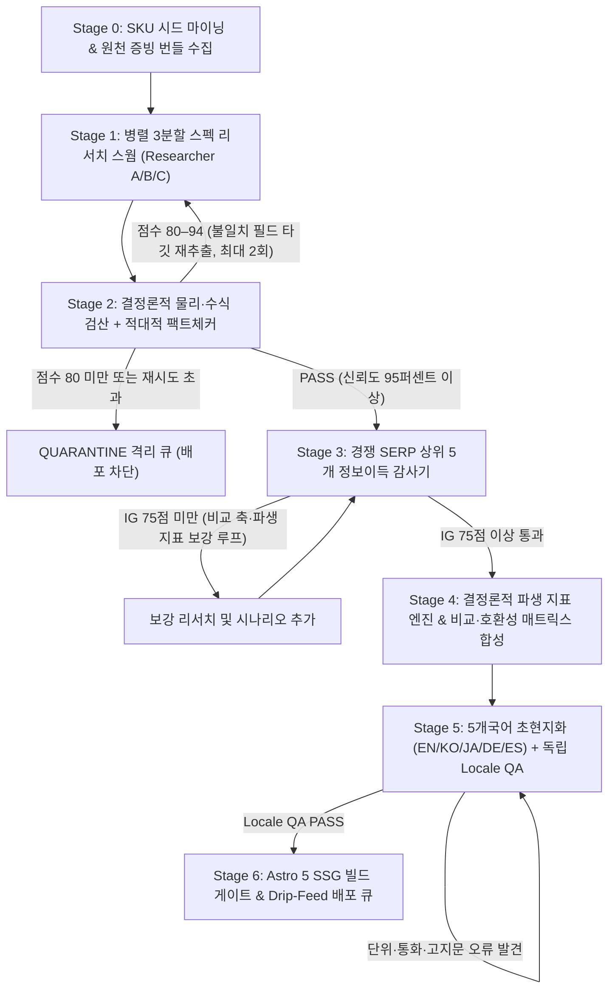

# 02. Token Burn Pipeline — 6단계 고토큰 실데이터 검증 & 초현지화 공장

## 1. 파이프라인 핵심 철학

대규모 추론 토큰 예산을 "SEO 블로그 글 대량 양산"에 사용하면 구글 스팸 정책에 즉각 적발된다. `specmatrix-global`은 토큰을 **글쓰기가 아니라 검증, 비교 감사, 초현지화**에 집중 소모하는 **6단계 적대적 실데이터 공장(6-Stage Adversarial Spec Factory)**을 가동한다.

- **핵심 원칙 1 — 출처 없는 숫자는 존재하지 않는 숫자다 (Evidence-Anchored Extraction)**: 모든 정량 스펙은 제조사 공식 스펙시트, PDF 매뉴얼, 영양성분표, 항공사 공식 규정, 규제 인증 DB의 원문 인용구와 URL에 고정된다.
- **핵심 원칙 2 — LLM에게 사칙연산을 맡기지 않는다 (Deterministic Math Separation)**: Wh 역산, 순수 단백질 1 g당 단가, 3년 전기요금 TCO, 멀티포트 출력 합산 검증은 100퍼센트 Python/TypeScript 결정론적 코드가 계산하며, LLM은 검산 완료된 숫자 테이블을 바탕으로 의사결정 해석만 작성한다.
- **핵심 원칙 3 — 기존 검색 상위 5개를 이기지 못하면 배포하지 않는다 (SERP Information Gain Gate)**: 모든 핵심 페이지와 비교 쌍은 현재 상위 SERP 문서를 분해 감사해 고유 정보이득 75점 이상을 달성해야만 통과한다.

---

## 2. 6단계 멀티에이전트 아키텍처



---

## 3. 단계별 상세 설계 및 검증 룰셋

### Stage 0: SKU 시드 마이닝 & 원천 증빙 번들 수집기 (Evidence Collector)

파이프라인의 입력 품질이 전체 DB의 신뢰도를 결정한다. 원천 소스는 엄격한 **4단계 신뢰 등급(Source Tiering)**으로 분류해 번들링한다.

| 출처 등급 | 원천 데이터 예시 | 허용 용도 |
| :--- | :--- | :--- |
| **Tier 1 (최우선 확정)** | 제조사 공식 PDF 매뉴얼, 공식 제품 스펙 페이지, 항공사 공식 수하물 규정 PDF, 공식 영양성분표(Nutrition Facts) | 모든 정량 스펙의 단일 진실 원천(SSOT) |
| **Tier 2 (공인 보조)** | 규제 인증 DB(FCC ID, KC 인증, PSE 마크, EASA/FAA 고시), 공식 브랜드 스토어 리스팅 | 인증 유무, 정격 입력 전압(100–240 V), 패키지 구성품 교차 확인 |
| **Tier 3 (전문 계측 공개치)** | BicycleRollingResistance(타이어 구름저항), ChargerLAB, 전문 오디오·전력 공개 측정 요약 | 제조사 미공개 실효 지표 보강 (반드시 출처 명시) |
| **Tier 4 (경고 신호 전용)** | Reddit, 클리앙, 도싸, Kakaku, Idealo 사용자 실사용 리포트 | **정량 스펙 채택 금지**, 실사용 함정(Gotchas) 후보 발굴 후 Stage 2 교차 검증 전용 |

- 수집된 원문 텍스트·표·PDF 청크는 `SHA-256` 해시와 함께 로컬 캐시(`data/evidence_cache/`)에 저장하여, 동일 매뉴얼이나 항공사 규정이 변경되지 않았을 때 불필요한 재파싱 토큰 소모를 차단한다.
- **이미지·다이어그램 이중 경로 추출(Dual-Path Vision)**: 영양성분표(Nutrition Facts) 이미지, 보조배터리·GaN 충전기 멀티포트 출력 배분 다이어그램, 스캔 PDF 매뉴얼은 텍스트 OCR 단독 처리 시 열 밀림(Column Shift) 오류가 빈번하므로, 반드시 고해상도 이미지 원본을 멀티모달 Vision 경로로 병행 입력해 Stage 2 적대적 감사에서 교차 대조한다.

---

### Stage 1: 병렬 3분할 스펙 리서치 스웜 (고토큰 구간 1 — 제품당 약 11만 토큰)

제품 1종을 단일 프롬프트로 요약하지 않고, **서로 다른 관점의 3명 전문 리서처 에이전트**가 증빙 번들을 독립 정독한다.

1. **Researcher A — Core Physical & Quantitative Extractor**
   - 물리 규격(무게 g, 크기 mm), 정격 용량(Wh, mAh, 셀 공칭전압 V), 단일·멀티포트 출력 조합표(C1 단독, C1+C2, C1+C2+A1), 영양성분표 전체(총 내용량, 1회 제공량, 서빙 수, 순수 단백질·크레아틴·나트륨·탄수화물 g, 칼로리), 자전거 부품 정밀 스펙(정확도 오차 범위, 스핀들/BB 규격, 타이어 TPI·중량), 홈테크 소비전력(Idle / Typical / Peak W, 소음 dBA, 연간 소모품 교체 주기).
2. **Researcher B — Protocol, Compatibility & Regulation Extractor**
   - 충전 프로토콜(USB-PD 3.1 EPR 140 W, PPS 범위, UFCS, QC 4.0), 항공 반입 핵심 속성(100 Wh 초과 여부, KC/PSE/CCC 마크, 본체 Wh 각인 여부), 구동계 호환성(Shimano 11/12s, SRAM AXS 12s, 프리허브 HG/Micro Spline/XDR, ANT+/BLE), NAS·MiniPC 확장 슬롯(M.2 NVMe, 2.5GbE/10GbE, ECC 지원, UPS USB HID 호환).
3. **Researcher C — Real-World Caveats & Edge-Case Extractor**
   - 구매 후 반품·불만족으로 직결되는 실무 함정 추출:
     - *WattCheck*: 멀티포트 신규 기기 삽입 시 전체 포트 순간 단절(Power Renegotiation Drop), 100 V 일본 환경에서 최대 와트 제한, 패스스루 충전 미지원.
     - *PureGram*: 아미노 스파이킹 의혹 성분(글리신·타우린 과다), 인공감미료·유당(WPC vs WPI) 민감도, 대용량 대비 스쿱 크기 편차.
     - *CycleGear*: 파워미터 포드와 에어로 프레임 체인스테이 클리어런스 간섭, Q-Factor 변화, 좌측 단일 vs 양측 밸런스 측정 한계.
     - *HomeTech*: 로봇청소기 직배수 키트 별매 비용, NAS 서드파티 HDD 호환 경고(잠금 정책), MiniPC 고부하 팬 소음 급증.

---

### Stage 2: 2중 적대적 팩트체크 (고토큰 구간 2 — 제품당 약 9만 토큰)

Stage 1 산출물은 **무조건 오류가 포함되어 있다고 가정**하고, 코드 기반 물리 검산과 적대적 LLM 감사관의 2단계 공격을 통과해야 한다.

#### 계층 1: 결정론적 물리·수학 검산기 (Python / Zod Rule Engine)

| 버티컬 | 강제 검산 수식 및 불변 조건 (Invariants) | 대표 적발 오류 |
| :--- | :--- | :--- |
| **WattCheck** | `abs(wh - (mah * nominal_v / 1000)) / wh <= 0.05` (셀 공칭전압 3.6–3.85 V 기준), `sum(active_ports_w) <= total_max_w`, `wh > 100 => carryon_no_approval == false`, `wh > 160 => carryon_allowed == false` | 5 V 정격 출력 용량과 3.7 V 셀 용량 혼동, 100 Wh 초과 제품의 기내 무조건 반입 오판 |
| **PureGram** | `abs(serving_size_g * servings_per_container - net_weight_g) / net_weight_g <= 0.05`, `protein_g + carbs_g + fat_g <= serving_size_g`, `abs((4*P + 4*C + 9*F) - kcal) / kcal <= 0.15` (식이섬유·당알코올 예외 보정), `active_g / serving_size_g <= 1.0` | 2스쿱 기준 영양성분을 1스쿱으로 오기재, 순수 유효성분 100퍼센트 초과 오류 |
| **CycleGear** | 파워미터 정확도 `0.5퍼센트 <= accuracy_err <= 3.0퍼센트`, 로드 타이어 폭 `23 <= width_mm <= 45`, 구동계 단수(11/12/13단) × 프리허브 호환 룰 테이블 불일치 차단 | Shimano 12단 카세트를 구형 10단 프리허브 호환으로 오판, 림/디스크 브레이크 규격 혼동 |
| **HomeTech** | `0 < standby_w <= idle_w <= typical_w <= peak_w <= psu_rated_w`, `15 <= noise_dba <= 85`, `annual_kwh == ((idle_w * idle_h + load_w * load_h) * 365) / 1000` | 소비전력(W)과 연간 전력량(kWh) 혼동, 대기전력이 부하전력보다 큰 모순 |

#### 계층 2: 적대적 감사 에이전트 (Adversarial Fact-Checker)

- 원천 증빙 번들과 Stage 1 JSON을 1:1 대조하여 **세대 혼동**(예: Anker 737 24K vs Prime 27K, Garmin Edge 840 vs 850, Roborock S8 vs S8 MaxV Ultra), **단위 오인식**, **구버전 규정 인용**을 적발한다.
- **판정 및 재시도 정책**:
  - `trust_score >= 95` 및 치명적 모순 0건: **PASS** (Golden DB 승격).
  - `80 <= trust_score < 95`: 불일치 필드 목록만 지정하여 Stage 1로 **타깃 재추출(최대 2회)** 지시.
  - `trust_score < 80` 또는 2회 재시도 후 미해결: 해당 필드를 `UNVERIFIED`로 격리하거나 전체 SKU를 `QUARANTINE` 큐로 이동해 배포를 영구 차단한다.

---

### Stage 3: 경쟁 SERP 대비 정보이득 감사기 (고토큰 구간 3 — 건당 약 4.5만 토큰)

기존 검색 결과의 동어반복을 막기 위해, 타깃 키워드의 상위 5개 SERP 스냅샷을 입력받아 **정보이득 점수(IG Score, 100점 만점)**를 정량 평가한다.

| 평가 항목 | 배점 | 채점 기준 |
| :--- | :--- | :--- |
| **고유 정량 스펙 우위** | 30점 | 상위 5개 경쟁 페이지 중 0–1곳만 제공한 정밀 수치(예: 멀티포트 조합별 출력표, 실측 구름저항 W, 아이들 전력 W) 3개 이상 확보 |
| **2차 파생 계산 지표** | 30점 | 경쟁 문서에 없는 계산 지표 3개 이상 제공 (실가용 Wh, 순수 유효성분 1 g 실단가, 3년 전기세+소모품 TCO) |
| **실사용 함정 및 호환성 경고** | 20점 | 반품·실패를 예방하는 구체적 엣지 케이스 2건 이상 명시 (단자 재협상 끊김, 체인스테이 간섭, 100 V 출력 저하 등) |
| **국가별 초현지화 가치** | 20점 | 해당 로케일 고유의 전기요금·전압·항공 규정·안전 인증(KC/PSE/CE/UL) 반영 |

- **통과 게이트**: `IG Score >= 75` 필수. 미달 시 Stage 3 보강 에이전트가 추가 비교 축·호환 기기 시나리오·파생 계산 항목을 발굴해 재심사한다.

---

### Stage 4: 결정론적 파생 지표 엔진 & 비교·호환성 매트릭스 합성 (건당 약 3.5만 토큰)

1. **의미 있는 페어링 규칙 (Anti-Noise Pairing)**: 모든 제품의 전체 조합($N \times (N-1)/2$)을 무분별하게 만들지 않는다. 동일 서브카테고리, 인접 가격대(±35퍼센트 이내), 동일 핵심 사용 시나리오(예: 100 Wh 미만 노트북 충전용 보조배터리끼리, 양측 파워미터끼리)를 만족하는 **고검색의도 상위 페어**만 선별한다.
2. **결정론적 사전 계산**: 비교 대상 A와 B의 모든 수치 격차(예: `"A가 B보다 무게 84 g 경량, 실가용 Wh는 6.2 Wh 우세, 순수 단백질 1 g당 단가는 14.3원 저렴"`)를 코드가 먼저 계산해 `derived_diff_table` JSON으로 고정한다.
3. **의사결정 해설 생성**: LLM은 고정된 `derived_diff_table`과 실사용 함정 데이터만 참조하여 **"이런 사용자라면 A, 이런 조건이라면 B"** 형태의 명확한 구매 판정 블록을 생성한다.

---

### Stage 5: 5개국어 초현지화 엔진 & 독립 Locale QA (고토큰 구간 4 — 기준 페이지당 약 4만 토큰)

EN / KO / JA / DE / ES 5개국어를 단순 번역하지 않고 **2-Pass 초현지화 파이프라인**으로 처리한다.

- **Pass 1 — 코드 기반 환경 치환 (Deterministic Localization)**:
  - 통화 변환, 단위 변환(`oz/lb` ↔ `g/kg`, `psi` ↔ `bar`), 가정용 전기요금 기본 단가 주입(US $0.17, KR 120–307원 한전 누진제, JP ¥31, DE €0.38, ES €0.20), 전압·플러그 매핑, 국가별 상단 항공사 정렬, 리전별 제휴 링크 및 법정 고지문 자동 삽입.
- **Pass 2 — 네이티브 초현지화 + 독립 Locale QA 에이전트**:
  - 버티컬별 5개국어 전문 용어 사전(Glossary)을 주입해 각 언어권 소비자 리뷰·기술 매체 특유의 자연스러운 문체로 재창작한다.
  - 독립된 **Locale QA Agent**가 아래 5대 항목을 검수해 1건이라도 발견 시 자동 수정 루프를 실행한다:
    1) 원본 언어 단위·통화 잔존 여부 (예: 독일어 페이지에 달러/파운드 방치)
    2) 핵심 숫자 변조 여부 (Stage 4의 `derived_diff_table` 숫자와 100퍼센트 일치 검증)
    3) 기계 번역투 및 부자연스러운 직역 표현
    4) 국가별 안전 인증(KC/PSE/CE/UL) 및 항공 규정 누락
    5) 법정 제휴 고지문(FTC·공정위·`[PR]`·`Werbung`) 누락

---

### Stage 6: 빌드 게이트, 자동 렌더링 감사 & Drip-Feed 배포

- **Zod 엄격 빌드 게이트**: 빌드 전 모든 Golden JSON과 다국어 페이로드를 Zod 스키마로 전수 검증한다.
- **정적 산출물 자동 감사**: 생성된 HTML에서 `NaN`, `undefined`, `null`, 빈 테이블, 깨진 내부 링크, `hreflang` 비대칭, `JSON-LD`(`Product`, `FAQPage`, `BreadcrumbList`) 스키마 오류를 0건으로 검증한다.
- **Drip-Feed 스케줄 배포**: `docs/03-VERTICAL-ROADMAP.md` 공통 규격의 `release_wave`(`1`–`4`) 필드에 따라 `RELEASE_WAVE_MAX` 환경변수로 1주차 200페이지 → 2주차 1,000페이지 → 4주차 5,000페이지 → 12주차 15,050페이지 코어 순으로 점진 개방하며, Google Search Console 색인율이 목표치 미만일 경우 즉시 배포 배치를 일시 중지(Circuit Breaker)한다.

---

## 4. 에이전트 간 JSON 입출력 계약 (Artifact Contracts)

### 계약 A: Stage 1 → Stage 2 (Evidence-Anchored Spec Payload 예시)

```json
{
  "schema_version": "2.0.0",
  "sku_id": "watt-anker-prime-27650-250w",
  "vertical": "wattcheck",
  "slug": "anker-prime-27650-250w",
  "release_wave": 1,
  "brand": "Anker",
  "model_name": "Anker Prime 27,650mAh Power Bank (250W)",
  "specs": {
    "rated_wh": {
      "value": 99.54,
      "unit": "Wh",
      "source_tier": 1,
      "source_url": "https://www.anker.com/products/a1340",
      "evidence_quote": "27,650mAh / 99.54Wh TSA-compliant battery capacity"
    },
    "nominal_mah": {
      "value": 27650,
      "unit": "mAh",
      "cell_nominal_v": 3.6,
      "source_tier": 1
    },
    "weight_g": {
      "value": 667,
      "unit": "g",
      "source_tier": 1
    },
    "port_matrix": [
      { "combo": "C1_only", "outputs_w": [140], "total_w": 140 },
      { "combo": "C1_plus_C2", "outputs_w": [140, 100], "total_w": 240 },
      { "combo": "C1_plus_C2_plus_A1", "outputs_w": [140, 92, 18], "total_w": 250 }
    ]
  },
  "certifications": {
    "ul": true,
    "ce": true,
    "pse": true,
    "kc": true
  },
  "citations": [
    { "label": "Anker Official Product Page A1340", "url": "https://www.anker.com/products/a1340", "verified_at": "2026-11-22" }
  ],
  "verified_at": "2026-11-22"
}
```

### 계약 B: Stage 2 적대적 감사 리포트 (Adversarial Audit Verdict 예시)

```json
{
  "sku_id": "watt-anker-prime-27650-250w",
  "math_invariants_passed": true,
  "math_checks": {
    "wh_recalc_expected": 99.54,
    "wh_deviation_pct": 0.0,
    "port_sum_valid": true,
    "airline_100wh_flag_valid": true
  },
  "adversarial_audit": {
    "trust_score": 98,
    "contradictions": [],
    "missing_evidence_fields": [],
    "retry_count": 0
  },
  "verdict": "PASS"
}
```

### 계약 C: Stage 3 경쟁 SERP 정보이득 감사 리포트 (IG Audit 예시)

```json
{
  "target_slug": "anker-prime-27650-vs-shargeek-170",
  "serp_top5_analyzed": 5,
  "ig_score": 88,
  "score_breakdown": {
    "unique_quantitative_specs": 26,
    "derived_metrics": 28,
    "real_world_caveats": 18,
    "localized_regulatory_value": 16
  },
  "serp_gaps_captured": [
    "2포트 동시 연결 시 MacBook Pro 16(140 W) 유지 여부 및 잔여 포트 출력 낙폭 비교",
    "변환효율 82퍼센트 기준 실가용 Wh 및 기종별 완충 횟수 계산",
    "2025년 한국 국토교통부 투명 파우치 규정 및 일본 PSE 마크·100 V 입력 호환 비교"
  ],
  "verdict": "PASS"
}
```

---

## 5. 토큰 소모량 정밀 시뮬레이션 (고용량 추론 파이프라인 가동 예산)

### 표 A: 파일럿 마일스톤 (Phase 1, 1–2주차 — 앵커 100종 + 30항공사 검증 / 200p → 1,000p 배포)

| 파이프라인 단계 | 처리 물량 | 단위당 평균 토큰 (입력+출력) | 예상 소모 토큰 |
| :--- | :--- | :--- | :--- |
| Stage 1: 병렬 3분할 스펙 리서치 | 100종 | 110,000 토큰 / 종 | 1,100만 토큰 |
| Stage 2: 적대적 교차 팩트체크 (재추출 포함) | 100종 | 90,000 토큰 / 종 | 900만 토큰 |
| Stage 3: 경쟁 SERP 정보이득 감사 | 150건 | 45,000 토큰 / 건 | 675만 토큰 |
| Stage 4: 1:1 비교·호환성 매트릭스 합성 | 150건 | 35,000 토큰 / 건 | 525만 토큰 |
| Stage 5: 5개국어 초현지화 + Locale QA | 200 기준 페이지 (5개국어 1,000p) | 40,000 토큰 / 기준 페이지 | 800만 토큰 |
| **Phase 1 합계** | **100종 검증 · 200p → 1,000p 단계 배포** | — | **약 4,000만 토큰** |

### 표 B: 1차 코어 완공 마일스톤 (Phase 1–3, 12주 누적 — 4대 버티컬 1,950종 / 1차 코어 15,050 SSG 페이지)

대상 제품 구성(`03-VERTICAL-ROADMAP.md` 기준): WattCheck 500종(+100항공사) + PureGram 600종 + CycleGear 450종 + HomeTech TCO 400종 = **총 1,950종**.  
1차 코어 배포 구성: 개별 제품 프로파일 1,950 + 핵심 선별 1:1 비교(`vs`) 700쌍 + 교차·호환·랭킹 허브 360(글로벌 통합 허브 10 포함) = **기준 3,010페이지 × 5개국어 = 15,050 SSG 페이지**.

| 파이프라인 단계 | 1차 코어 누적 물량 | 단위당 평균 토큰 (입력+출력) | 총 소모 토큰 | 전체 비중 |
| :--- | :--- | :--- | :--- | :--- |
| **Stage 1**: 병렬 3분할 스펙 리서치 | 1,950종 | 110,000 토큰 / 종 | 2억 1,450만 토큰 | 32.0퍼센트 |
| **Stage 2**: 적대적 교차 팩트체크 + 재시도 루프 | 1,950종 | 90,000 토큰 / 종 | 1억 7,550만 토큰 | 26.2퍼센트 |
| **Stage 3**: 경쟁 SERP 정보이득 감사 | 2,000건 (핵심 클러스터·비교군) | 45,000 토큰 / 건 | 9,000만 토큰 | 13.4퍼센트 |
| **Stage 4**: 비교(`vs` 700) + 호환·교차(350) 합성 | 1,050건 | 35,000 토큰 / 건 | 3,675만 토큰 | 5.5퍼센트 |
| **Stage 5**: 5개국어 초현지화 + 독립 Locale QA | 3,010 기준 페이지 (× 5로케일) | 40,000 토큰 / 기준 페이지 | 1억 2,040만 토큰 | 18.0퍼센트 |
| **Stage 6**: 빌드 게이트 미달 페이지 보강·재생성 버퍼 | 전체 약 5퍼센트 재생성 | — | 3,285만 토큰 | 4.9퍼센트 |
| **1차 코어 누계 (Phase 1–3)** | **1,950종 / 15,050 SSG 페이지** | — | **약 6억 7,000만 토큰** | **100퍼센트** |

- **풀 확장 상한선 (29,550 SSG 페이지 선택 시)**: GSC 색인율 75퍼센트 이상 안착 후 고전환 1:1 VS(추가 2,100쌍) 및 교차·호환 페이지(추가 800건)를 총 2,900 기준 페이지(× 5개국어 = +14,500p) 증축할 경우 **추가 약 2억 7,500만 토큰**(누적 **약 9억 4,500만 토큰**)이 투입된다.
- **Phase 4 월간 지속 운영(Freshness Loop)**: 매월 신제품 80–120종 자동 편입, 항공사 규정·영양성분 리뉴얼 변경 감시, GSC 노출 대비 클릭률(CTR) 하위 10퍼센트 페이지의 SERP 정보이득 재감사에 **월 약 6,000만–9,000만 토큰**을 순환 투입하여 사이트 신선도와 검색 순위를 지속 방어한다.

---

## 6. 배치 오케스트레이션, 상태 머신 및 인간 검수(HITL) 프로토콜

대규모 파이프라인이 중간에 중단되거나 중복 과금(토큰 낭비)되지 않도록 로컬 SQLite/DuckDB 기반 **멱등성 상태 머신(`pipeline_jobs`)**으로 실행을 통제한다.

### 작업 상태 전이 규칙

`PENDING` → `EVIDENCE_READY` → `RESEARCHED` → `AUDITED_PASS` → `IG_PASSED` → `SYNTHESIZED` → `LOCALIZED_PASS` → `READY_FOR_DRIP` → `PUBLISHED`  
*(실패 시 `RETRY_STAGE_1`, `RETRY_STAGE_3`, `RETRY_STAGE_5`로 분기하며, 최대 재시도 초과 시 `QUARANTINED` 영구 격리)*

### 운영 안정성 4대 장치

1. **증빙 해시 캐싱**: 동일 제조사 PDF나 항공사 규정 문서의 `SHA-256` 해시가 일치하면 Stage 0–1을 건너뛰어 재실행 토큰 낭비를 0으로 억제한다.
2. **배치 단위 병렬화 및 서킷 브레이커**: 1회 배치당 20–50종 단위로 병렬 처리하며, 배치 내 `QUARANTINED` 비율이 15퍼센트를 초과하면 즉시 배치를 자동 중지하고 프롬프트 또는 원천 파서 결함을 점검한다.
3. **인간 표본 검수 (Human-in-the-Loop 5퍼센트 샘플링)**: 각 버티컬 배치마다 무작위 5퍼센트 레코드와 최상위 검색량 핵심 SKU 10종을 도메인 리뷰어가 직접 스팟 체크한다. 특히 **CycleGear(로드사이클 실사용 도메인)**와 **WattCheck(전자회로·전원·PD 출력 도메인)**는 현업 전문성으로 에이전트 룰셋을 즉시 정교화할 수 있는 핵심 우위 구간이다.
4. **버전 추적 및 롤백**: 모든 Golden JSON 스냅샷은 Git 커밋 단위로 관리하여, 특정 배치에서 스키마·가격 이상이 감지되면 1분 내에 직전 정상 스냅샷으로 롤백할 수 있다.
