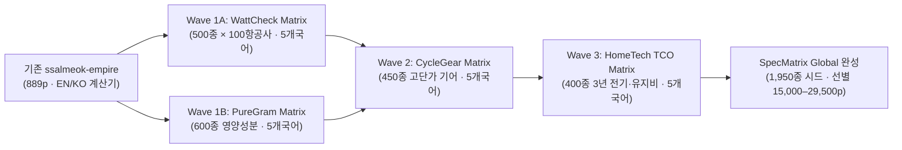

# 03. 4대 고수익 버티컬 로드맵, 실데이터 JSON 스키마 및 페이지 확장 공식

> **문서 목적**: 기존 `ssalmeok-empire`(2개국어 889페이지 계산기 사이트군)의 검증된 자산을 계승하면서, **5개국어(EN/KO/JA/DE/ES) × 실제품 1,950종 정밀 스펙 비교 매트릭스 공장**으로 도약하기 위한 4대 버티컬 선정, JSON 표준 스키마, 킬러 인터랙티브 모듈, 그리고 색인 블로트를 억제한 페이지 확장 공식을 정의한다.

---

## 1. 기존 `ssalmeok-empire` 자산 계승 및 4대 버티컬 포트폴리오

기존 `ssalmeok-empire`는 `site1-wattcheck`(32개 항공사·42개 기기, 201p), `site2-worthmove`(336p), `site3-puregram`(48개 제품, 352p)로 총 889개 SSG 라우트를 가동 중이다. 그러나 계산기·규정 위주 구조는 **"특정 제품 모델명 + 호환성/실단가/1:1 비교"**를 검색하는 구매 직전(Bottom-of-Funnel) 하이엔텐트 트래픽을 흡수하는 데 한계가 있다.

`specmatrix-global`은 기존 1호기(WattCheck)와 3호기(PureGram)를 실제품 중심 매트릭스로 초확장하고, 운영자의 실사용 도메인인 로드사이클(**CycleGear**)과 글로벌 고검색량·고객단가 생활가전·홈서버(**HomeTech TCO**)를 더해 4대 고수익 버티컬을 완성한다.

| 출시 웨이브 | 버티컬 코드 | 핵심 포지셔닝 | 1차 실제품 시드 | 평균 객단가(AOV) | 핵심 수익 레버 (iHerb 영구 금지) | 5개국어 현지화(Information Gain) 핵심 축 | 도메인 리뷰어 검수 해자 |
| :--- | :--- | :--- | :--- | :--- | :--- | :--- | :--- |
| **Wave 1A** | **WattCheck Matrix** | 보조배터리·GaN 충전기·파워뱅크 × 100개 항공사 기내 반입 + USB-PD 포트 분배 | **500종** (+100항공사) | 4만–35만 원 | Amazon·쿠팡·알리 초고전환 + 여행 시즌 스파이크 | 국가별 플러그(Type A/C/F)·전압(100–230 V)·PSE/CCC/국토부 절연 규정 | 전력(W/Wh)·회로·PD 프로토콜 엔지니어링 검수 |
| **Wave 1B** | **PureGram Matrix** | 프로틴·크레아틴·전해질·에너지젤 영양성분 전수 파싱 + 순수 유효성분 1 g당 실단가 | **600종** | 3만–13만 원 | 쿠팡·Amazon 정기 재구매 (**iHerb 영구 미사용**) | 국가별 로컬 베스트셀러(ON/마이프로틴/SAVAS/ESN/HSN) + 통화별 1 g 단가 | 기존 48종 운영 노하우 + 에너지젤 실사용 검수 |
| **Wave 2** | **CycleGear Matrix** | 파워미터·GPS 사이클링 컴퓨터·스마트 트레이너·타이어 CRr·Di2/AXS 호환성 | **450종** | **20만–200만 원** | 고단가 제휴(Bike24/Awin/AvantLink/알리/Amazon) + 고CPC | 5대 자전거 강국(미/한/일/독/스페인) 통화·배송·규격·날씨별 타이어 추천 | **운영자 로드사이클 실사용 도메인(최강 E-E-A-T)** |
| **Wave 3** | **HomeTech TCO Matrix** | MiniPC·NAS·UPS·로봇청소기 소비전력(W)·연간 전기요금·소음(dB)·3년 유지비 TCO | **400종** | **30만–180만 원** | 고단가 전자·IT 애드센스 RPM + 직영몰·Amazon·알리 | **국가별 전기요금 격차**(독일 0.38 EUR vs 미국 0.17 USD vs 한전 누진제) | 저전력 소비전력(W)·UPS 부하 계산·홈서버 실무 |
| **합계** | **4대 통합 매트릭스** | **구매 직전 하이엔텐트 실데이터 비교 공장** | **1,950종** | **평균 35만 원+** | **애드센스 + 다중 리전 제휴** | **EN / KO / JA / DE / ES (5개국어 완전 현지화)** | **단순 AI 생성물과 격차가 큰 정량 검증 DB** |



---

## 2. 전 버티컬 공통 멀티로케일 엔티티 규격 (Base Envelope)

4개 버티컬은 서로 다른 도메인 스펙(`specs`)을 가지지만, 파이프라인 검증·5개국어 현지화·가격 스냅샷·Drip-Feed 배포 제어를 단일 코드베이스로 돌리기 위해 아래 공통 메타 필드를 모든 JSON 파일에 강제한다.

| 공통 필드 | 타입 | 필수 여부 | 용도 및 검증 규칙 |
| :--- | :--- | :--- | :--- |
| `schema_version` | string | 필수 | 예: `"2.0.0"` — 스키마 마이그레이션 및 빌드 검증 기준 |
| `vertical` | enum | 필수 | `"wattcheck"` / `"puregram"` / `"cyclegear"` / `"hometech"` |
| `slug` | string | 필수 | 영문 소문자 케밥케이스 고정(전 로케일 URL 공유로 `hreflang` 매핑 단순화) |
| `release_wave` | integer | 필수 | `1`–`4` 단계 지정 — Drip-Feed 점진 배포 시 `RELEASE_WAVE_MAX` 필터 기준 |
| `i18n` | object | 필수 | `en`, `ko`, `ja`, `de`, `es` 5개 키 각각 `title`, `summary`, `local_gotchas` 보유 |
| `regional_offers` | object | 필수 | `us`, `kr`, `jp`, `de`, `es`별 `asin`/`sku`, `msrp`, `currency`, `search_query`, `availability_status` |
| `citations` | array | 필수 | 제조사 공식 스펙시트·매뉴얼·공식 시험 성적서 URL과 확인 일자(최소 2개 이상) |
| `audit` | object | 필수 | `fact_checked_at`, `adversarial_pass`, `info_gain_score`(0–100), `human_spot_checked` |

### 5개국어 현지화(Transcreation) 기본 파라미터 테이블

단순 번역이 아니라 국가별 물리 규격과 비용 파라미터를 계산기에 자동 주입해 **동일 제품이라도 로케일마다 독자적 정보 이득(Information Gain)**을 생성한다.

| 로케일 | 타깃 권역 | 기준 통화 | 상용 전압 / 주파수 / 플러그 | 표준 전기요금 프리셋 (HomeTech) | 핵심 로컬 규제·인증·단위 |
| :--- | :--- | :--- | :--- | :--- | :--- |
| `en` | 미국·영국·캐나다·글로벌 | `USD` (선택 `GBP`/`CAD`) | 120 V / 60 Hz / Type A·B | 0.17 USD/kWh (주별 조정) | TSA/FAA PackSafe, UL/ETL, lb/oz·psi 병기 |
| `ko` | 대한민국 | `KRW` | 220 V / 60 Hz / Type C·F | 한전 주택용 누진제(120–307 KRW/kWh) | 국토부 2025–2026 기내 절연·선반금지, KC 인증, g/kg·bar |
| `ja` | 일본 | `JPY` | 100 V / 50–60 Hz / Type A | 31 JPY/kWh (전력사별 프리셋) | PSE 인증 필수, 일본 국토교통성(MLIT) 기내 규정, g/kg |
| `de` | 독일·오스트리아·스위스(DACH) | `EUR` | 230 V / 50 Hz / Type F(Schuko) | **0.38 EUR/kWh** (초고단가) | EASA 규정, CE/GS 인증, StVZO(자전거 전조등), g/kg·bar |
| `es` | 스페인·중남미(LATAM) | `EUR` (선택 `USD`/`MXN`) | 230 V / 50 Hz / Type F | 0.20 EUR/kWh (PVPC 기준) | EASA/AESA 규정, CE 인증, 스페인어권 현지 쇼핑몰 연동 |

---

## 3. 버티컬 1: WattCheck Matrix (보조배터리·GaN 충전기·파워뱅크 초확장)

### 3.1 기존 `site1-wattcheck` 대비 진화 방향

기존 `site1-wattcheck`는 32개 항공사 규정과 42개 대표 기기(스마트폰·노트북) 위주의 계산기를 제공했으나, 실제 소비자가 지갑을 여는 순간 검색하는 쿼리는 **"Anker Prime 27650 대한항공 기내반입"**, **"UGREEN Nexode Pro 160W 맥북프로 아이폰 동시 충전 출력"**, **"Shargeek 170 일본 ANA 반입 가능 여부"**처럼 **실제품 모델명 + 항공사/멀티포트 호환성**에 집중되어 있다.

### 3.2 500종 실제품 + 100개 항공사 시드 구성

| 세그먼트 | 시드 수량 | 주요 포함 브랜드 및 앵커 모델 | 핵심 차별화 스펙 (일반 쇼핑몰에 없는 데이터) |
| :--- | :--- | :--- | :--- |
| **기내 반입형 보조배터리 (5,000–27,650 mAh)** | 220종 | Anker Prime/Zolo/Nano, UGREEN Nexode, Baseus Blade/Elf, Shargeek 170/140, Cuktech 10/15/20, Xiaomi, 삼성 정품, 아트뮤, CIO(일본 인기) | 정격 용량(Rated mAh) vs 표기 용량 실효율(퍼센트), 본체 Wh 각인 유무, **99.9 Wh 한계선 정밀 판정**, 항공기 선반/사용 제한 경고 |
| **멀티포트 GaN 충전기 (45 W–300 W)** | 180종 | Anker Prime 100 W–250 W, UGREEN Nexode Pro 65 W–300 W, Satechi, Belkin, Baseus, SlimQ, 아트뮤, CIO NovaPort | **전 포트 조합별 출력 분배 매트릭스**(1포트/2포트/3포트/4포트), 포트 추가 연결 시 순간 단절(`renegotiation_drop`) 여부, 삼성 45 W PPS 2.0(5 A) 실제 지원 여부 |
| **휴대용 파워스테이션·캠핑 LiFePO4 (150–1,000 Wh)** | 60종 | EcoFlow RIVER 3 / DELTA, Jackery Explorer, Anker SOLIX, Bluetti AC/EB 시리즈 | 항공 반입 불가(160 Wh 초과) 경고 + 대체 기내 가능 모델 매핑, UPS 절체시간(ms), 팬 소음(dB) |
| **240 W 케이블·트래블 어댑터·절연 파우치** | 40종 | Anker 543/Zolo, UGREEN 240 W, Zendure Passport, Epicka, Lencent, 방염 절연 파우치 | E-Marker 칩 내장 여부, 5 A PPS 지원 여부, 접지 유무, 퓨즈 정격(8 A/10 A) |
| **글로벌 항공사·항공당국 규정 DB** | **100개사** | 한국 11(대한·아시아나·제주·티웨이·진에어 등), 북미 15(TSA/Delta/United/AA 등), 유럽 25(Lufthansa/BA/AF/Ryanair 등), 아태 30(ANA/JAL/SQ/CX/CA 등), 중동·중남미 19(Emirates/Qatar 등) | 100 Wh 무승인 한도·최대 개수, 101–160 Wh 승인 가능 여부, **기내 선반 보관 금지**, **기내 충전/사용 금지**, 중국 국내선 CCC 마크 의무 여부, 단자 절연 파우치 필수 여부 |

### 3.3 JSON 스키마 샘플 (WattCheck Matrix)

```json
{
  "schema_version": "2.0.0",
  "vertical": "wattcheck",
  "category": "power-bank",
  "slug": "anker-prime-27650mah-250w",
  "release_wave": 1,
  "brand": "Anker",
  "model_number": "A1340",
  "specs": {
    "nominal_capacity_mah": 27650,
    "rated_capacity_mah_5v": 15500,
    "battery_energy_wh": 99.54,
    "nominal_voltage_v": 3.6,
    "cell_chemistry": "Li-ion 21700",
    "wh_printed_on_body": true,
    "ccc_certified": true,
    "pse_certified": true,
    "kc_certified": true,
    "weight_g": 667,
    "dimensions_mm": { "l": 161.7, "w": 57.0, "h": 49.7 },
    "max_total_output_w": 250,
    "max_single_port_output_w": 140,
    "max_input_w": 170,
    "supports_pd_3_1_epr": true,
    "supports_samsung_pps_45w": true,
    "supports_pass_through": true,
    "power_renegotiation_drop": false,
    "ports": [
      { "id": "C1", "type": "USB-C", "max_w": 140, "protocols": ["PD 3.1", "PPS 5A", "QC 3.0"] },
      { "id": "C2", "type": "USB-C", "max_w": 140, "protocols": ["PD 3.1", "PPS 5A", "QC 3.0"] },
      { "id": "A1", "type": "USB-A", "max_w": 65, "protocols": ["QC 3.0", "SCP"] }
    ],
    "port_allocation_matrix": [
      { "active_ports": ["C1"], "output_w": { "C1": 140 } },
      { "active_ports": ["C1", "C2"], "output_w": { "C1": 140, "C2": 100 } },
      { "active_ports": ["C1", "A1"], "output_w": { "C1": 140, "A1": 65 } },
      { "active_ports": ["C1", "C2", "A1"], "output_w": { "C1": 140, "C2": 92, "A1": 18 } }
    ]
  },
  "airline_compliance_profile": {
    "iata_tier": "under_100wh_no_approval",
    "tsa_faa_carry_on": "allowed",
    "checked_baggage": "prohibited",
    "korea_molit_2026_notes": "under_100wh_max_5_pcs_zip_pouch_no_overhead_no_inflight_use",
    "china_domestic_ccc_ok": true,
    "auto_evaluated_airlines_count": 100
  },
  "regional_offers": {
    "us": { "asin": "B0BYP2F3SG", "msrp": 179.99, "currency": "USD", "search_query": "Anker Prime 27650mAh 250W A1340", "status": "IN_STOCK" },
    "kr": { "sku": "A1340-KR", "msrp": 249000, "currency": "KRW", "search_query": "앤커 프라임 27650mAh 250W A1340", "status": "IN_STOCK" },
    "jp": { "asin": "B0BYP2F3SG", "msrp": 24990, "currency": "JPY", "search_query": "Anker Prime Power Bank 27650mAh 250W", "status": "IN_STOCK" },
    "de": { "asin": "B0BYP2F3SG", "msrp": 189.99, "currency": "EUR", "search_query": "Anker Prime 27650mAh 250W Powerbank", "status": "IN_STOCK" },
    "es": { "asin": "B0BYP2F3SG", "msrp": 189.99, "currency": "EUR", "search_query": "Anker Prime 27650mAh 250W bateria externa", "status": "IN_STOCK" }
  },
  "i18n": {
    "en": {
      "title": "Anker Prime 27,650mAh 250W (99.54 Wh) Airline & USB-PD Matrix",
      "summary": "Engineered at 99.54 Wh to sit just below the 100 Wh no-approval flight cap while delivering dual 140 W + 100 W USB-C laptop charging.",
      "local_gotchas": ["Requires 240 W E-Marker cable to reach 140 W EPR speed on MacBook Pro 16."]
    },
    "ko": {
      "title": "앤커 프라임 27,650mAh 250W (99.54 Wh) 항공사 기내반입·출력 분배표",
      "summary": "99.54 Wh 정격 설계로 항공사 사전 승인 없이 기내 휴대 가능한 최대 용량이며 C1+C2 동시 140 W + 100 W 출력을 지원합니다.",
      "local_gotchas": ["한국 출발 항공편은 100 Wh 이하라도 단자 절연(투명 지퍼백) 및 기내 선반 보관 금지 규정을 준수해야 합니다."]
    },
    "ja": {
      "title": "Anker Prime 27,650mAh 250W (99.54 Wh) 機内持ち込み・PD出力配分",
      "summary": "100 Wh未満の99.54 Wh設計でANA・JALの機内持ち込みに対応し、PSE認証取得済みの高出力モバイルバッテリーです。",
      "local_gotchas": ["日本国内販売モデル（PSEマーク印字）か購入前に確認が必要です。"]
    },
    "de": {
      "title": "Anker Prime 27.650 mAh 250 W (99,54 Wh) Flugzeug-Check & PD-Matrix",
      "summary": "Mit exakt 99,54 Wh unterhalb der 100-Wh-EASA-Grenze ohne Voranmeldung bei Lufthansa & Co. im Handgepäck erlaubt.",
      "local_gotchas": ["Für 140 W PD 3.1 wird ein zertifiziertes 240-W-USB-C-Kabel benötigt."]
    },
    "es": {
      "title": "Anker Prime 27.650 mAh 250 W (99,54 Wh): Vuelo y Matriz USB-PD",
      "summary": "Diseñada con 99,54 Wh para cumplir el límite de 100 Wh en cabina sin aprobación previa y cargar dos portátiles a la vez.",
      "local_gotchas": ["Prohibida en equipaje facturado en Iberia, Vueling y todas las aerolíneas IATA."]
    }
  },
  "citations": [
    { "label": "Anker A1340 Official User Manual", "url": "https://support.anker.com/s/product/a085g000004x6qCAAQ", "verified_at": "2026-11-22" },
    { "label": "IATA Lithium Battery Guidance", "url": "https://www.iata.org/en/programs/cargo/dgr/lithium-batteries/", "verified_at": "2026-11-22" }
  ],
  "audit": {
    "fact_checked_at": "2026-11-22",
    "adversarial_pass": true,
    "info_gain_score": 94,
    "human_spot_checked": false
  }
}
```

### 3.4 페이지 확장 공식 및 색인 블로트 제어 (WattCheck)

단순 곱셈(500종 × 100항공사 = 50,000p)은 명백한 중복·색인 블로트 위험을 초래한다. 따라서 **교차 판정은 인터랙티브 매트릭스로 흡수**하고, 검색량이 검증된 핵심 조합만 정적 페이지로 발행한다.

| URL 패턴 (`01-MASTER-PLAN.md` 4대 아키타입 준수) | 산출 공식 | 5개국어 총 페이지 | 색인 전략 |
| :--- | :--- | :--- | :--- |
| `/{locale}/wattcheck/item/{slug}` (Type A) | 500종 × 5개국어 | **2,500p** | 전량 색인(내부 항공사 100개사 즉시 조회 위젯 + PD 조합 시뮬레이터 탑재) |
| `/{locale}/wattcheck/matrix/airline-{airline-slug}` (Type D) | 100항공사 × 5개국어 | **500p** | 전량 색인(해당 항공사 반입 가능 추천 TOP 15 제품 매트릭스 자동 연동) |
| `/{locale}/wattcheck/vs/{slugA}-vs-{slugB}` (Type B) | 동급 고수요 700쌍(`slugA < slugB` 정규화) × 5개국어 | **3,500p** | 전량 색인(포트 분배 차이·무게당 Wh 밀도·기내 규정 승패표) |
| `/{locale}/wattcheck/matrix/device-{device}-charger` (Type D) | 인기 기기 100종 × 충전기/배터리 허브 × 5개국어 | **500p** | 전량 색인(예: MacBook Pro 16 / Galaxy S25 Ultra / Steam Deck 최적 충전 매트릭스) |
| `/{locale}/wattcheck/compat/{product}-with-{airline}` (Type C) | 초고검색량 제품 30종 × 주요 항공사 10개 × 5개국어 | **1,500p** | **Wave 3 선별 색인**(나머지 49,700개 조합은 제품 페이지 내 인터랙티브 조회로 처리) |
| **WattCheck 소계** | **핵심 선별 정적 생성** | **8,500p** | **(1차 집중 발행 4,500p + 2차 확장 4,000p)** |

---

## 4. 버티컬 2: PureGram Matrix (글로벌 보충제·에너지젤 600종 영양성분 파싱 DB)

### 4.1 기존 `site3-puregram` 대비 진화 방향

기존 `site3-puregram`(48종, EN/KO)의 강점인 **"스쿱 필러세(Filler Tax) 및 순수 유효성분 1 g당 실단가"** 공식을 전 세계 5개국 로컬 베스트셀러 600종으로 12.5배 확장한다. 특히 **지구력 스포츠 에너지젤·카보 드링크(포도당:과당 1:0.8 비율, 탄수화물 1 g당 단가, 카페인·나트륨 함량)** 카테고리를 신설해 버티컬 3(CycleGear)과 강력한 내부 링크 시너지를 만든다.

### 4.2 600종 실제품 시드 구성 (로컬 베스트셀러 분산 배치)

| 카테고리 | 시드 수량 | 기준 단가 단위 (`benchmark_unit`) | 주요 글로벌·로컬 앵커 브랜드 | 핵심 감사(Audit) 지표 |
| :--- | :--- | :--- | :--- | :--- |
| **유청 프로틴 (WPI / WPC / 가수분해)** | 200종 | 순수 단백질 10 g당 단가 | ON, Dymatize, Myprotein, Ghost, 셀렉스, 닥터유, SAVAS(JP), REYS(JP), ESN(DE), HSN(ES) | 스쿱 순도(퍼센트), WPI 제1원료 여부, 아미노 스파이킹(타우린·글리신 첨가) 경고, 칼로리/단백질 비율 |
| **식물성·비건 프로틴** | 80종 | 순수 단백질 10 g당 단가 | Orgain, Vega, Transparent Labs, 마이프로틴 완두, VALX(JP), Foodspring(DE) | 완두·현미 아미노산 상보 배합 여부, 1회분 나트륨·식이섬유 함량 |
| **크레아틴 (모노·Creapure·HCl)** | 80종 | 순수 크레아틴 5 g당 단가 | Thorne, Optimum, Nutricost, Myprotein, ESN Ultrapure, HSN Creapure | **Creapure 독일 정품 원료 여부**, 30일 유지비, 200메쉬 미분화 여부 |
| **전해질·수분보충 파우더** | 80종 | 순수 나트륨+칼륨 1,000 mg당 단가 | LMNT, Liquid I.V., Nuun, Skratch Labs, Precision Hydration, 포카리 파우더(KR/JP) | 나트륨/칼륨/마그네슘 실함량, 설탕·말토덱스트린 비중, 삼투압 구분 |
| **지구력 에너지젤·카보믹스 (신규)** | 90종 | 순수 탄수화물 30 g당 단가 | **Maurten Gel 100/160, SiS Beta Fuel, Precision PF 30/90, GU Roctane, Enervit, 아미노바이탈(JP), 요헤미티/코오롱(KR)** | **포도당:과당 비율(1:0.8 vs 2:1)**, 시간당 90 g 섭취 시 비용, 카페인(mg)·위장 부담 지수 |
| **오메가3 (rTG/EE) & RTD 프로틴** | 70종 | EPA+DHA 1,000 mg / 단백질 20 g당 단가 | Sports Research, Nordic Naturals, Carlson, 종근당, 더단백, Fairlife, Barebells | rTG 여부, 순도(캡슐 중량 대비 EPA+DHA 비율), IFOS 5-Star 인증, 당류 함량 |

### 4.3 JSON 스키마 샘플 (PureGram Matrix — 에너지젤 확장형)

```json
{
  "schema_version": "2.0.0",
  "vertical": "puregram",
  "category": "energy-gel",
  "slug": "maurten-gel-100-caf-100-box-12",
  "release_wave": 1,
  "brand": "Maurten",
  "origin_country": "SE",
  "package_spec": {
    "total_servings": 12,
    "serving_weight_g": 40,
    "unit_type": "packet",
    "flavors_tracked": ["Unflavored Hydrogel"]
  },
  "nutrition_label": {
    "calories_kcal": 100,
    "active_ingredient_type": "carbohydrates",
    "active_per_serving_g": 25.0,
    "carb_ratio_glucose_to_fructose": "1:0.8",
    "caffeine_mg": 100,
    "sodium_mg": 22,
    "potassium_mg": 0,
    "sugar_g": 25.0,
    "hydrogel_encapsulation": true
  },
  "derived_math": {
    "purity_pct": 62.5,
    "total_pure_active_g": 300.0,
    "benchmark_unit_g": 30.0,
    "servings_for_90g_per_hour": 3.6,
    "amino_spiking_risk": "none",
    "purity_grade": "A+"
  },
  "certifications": ["Informed Sport", "Vegan"],
  "regional_offers": {
    "us": { "asin": "B07Q6H5M5Q", "msrp": 52.80, "currency": "USD", "search_query": "Maurten Gel 100 Caf 100 box 12", "status": "IN_STOCK" },
    "kr": { "sku": "MAURTEN-CAF100-12", "msrp": 72000, "currency": "KRW", "search_query": "모르텐 젤 100 카페인 12개입", "status": "IN_STOCK" },
    "jp": { "asin": "B07Q6H5M5Q", "msrp": 14040, "currency": "JPY", "search_query": "モルテン ジェル100 CAF100 12個", "status": "IN_STOCK" },
    "de": { "asin": "B07Q6H5M5Q", "msrp": 49.00, "currency": "EUR", "search_query": "Maurten Gel 100 Caf 100 12er Box", "status": "IN_STOCK" },
    "es": { "asin": "B07Q6H5M5Q", "msrp": 49.00, "currency": "EUR", "search_query": "Maurten Gel 100 Caf 100 caja 12", "status": "IN_STOCK" }
  },
  "i18n": {
    "en": {
      "title": "Maurten Gel 100 Caf 100: True Cost per 30 g Carbs & 1:0.8 Ratio Audit",
      "summary": "Hydrogel-encapsulated 25 g carbs with 100 mg caffeine at a 1:0.8 fructose-to-glucose ratio for high-intake marathon and cycling blocks.",
      "local_gotchas": ["Low sodium (22 mg); pair with a dedicated electrolyte mix during hot races."]
    },
    "ko": {
      "title": "모르텐 젤 100 카페인(Caf 100): 순수 탄수화물 30 g당 실단가·비율 분석",
      "summary": "하이드로겔 캡슐화 기술로 위장 부담을 줄이면서 1:0.8 고흡수 비율의 탄수화물 25 g과 카페인 100 mg을 공급합니다.",
      "local_gotchas": ["포당 단가가 일반 젤 대비 2배 이상이므로 훈련용은 가성비 젤, 실전 대회용은 모르텐으로 이원화하는 전략이 유리합니다."]
    },
    "ja": {
      "title": "モルテン GEL 100 CAF 100：純炭水化物30 gあたり実質単価と比率分析",
      "summary": "ハイドロゲル技術とグルコース・フルクトース1対0.8配合で高強度レース時の胃腸トラブルを抑えます。",
      "local_gotchas": ["日本正規価格は割高なため、1時間あたり90 g補給時のコスト比較が必須です。"]
    },
    "de": {
      "title": "Maurten Gel 100 Caf 100: Echter Preis pro 30 g Kohlenhydrate",
      "summary": "Hydrogel-Matrix mit 25 g Kohlenhydraten im 1:0,8-Verhältnis und 100 mg Koffein für Radrennen und Marathon.",
      "local_gotchas": ["Nur 22 mg Natrium pro Gel – bei Hitze zwingend mit Elektrolyten kombinieren."]
    },
    "es": {
      "title": "Maurten Gel 100 Caf 100: Coste real por 30 g de carbohidratos",
      "summary": "Hidrogel con 25 g de hidratos en proporción 1:0,8 y 100 mg de cafeína pensado para ciclismo y maratón.",
      "local_gotchas": ["Contenido muy bajo en sodio (22 mg); complementar con sales minerales."]
    }
  },
  "citations": [
    { "label": "Maurten Official Nutrition Facts", "url": "https://www.maurten.com/products/gel-100-caf-100", "verified_at": "2026-11-22" },
    { "label": "Informed Sport Certified List", "url": "https://sport.wetestyoutrust.com/supplement-search", "verified_at": "2026-11-22" }
  ],
  "audit": {
    "fact_checked_at": "2026-11-22",
    "adversarial_pass": true,
    "info_gain_score": 92,
    "human_spot_checked": true
  }
}
```

### 4.4 페이지 확장 공식 (PureGram Matrix)

| URL 패턴 (`01-MASTER-PLAN.md` 4대 아키타입 준수) | 산출 공식 | 5개국어 총 페이지 | 비고 |
| :--- | :--- | :--- | :--- |
| `/{locale}/puregram/item/{slug}` (Type A) | 600종 × 5개국어 | **3,000p** | 사용자 직접 가격 수정 가능한 실시간 필러세 계산기 내장 |
| `/{locale}/puregram/vs/{slugA}-vs-{slugB}` (Type B) | 동일 카테고리 고검색 850쌍(`slugA < slugB` 정규화) × 5개국어 | **4,250p** | 순수 1 g당 절감액·30일 습관 비용·아미노 스파이킹 비교 |
| `/{locale}/puregram/matrix/{category-facet}` (Type D) | 6카테고리 × 15개 세부 조건(저당/비건/Creapure/1:0.8젤 등) × 5개국어 | **450p** | 인터랙티브 정렬 랭킹 리더보드 |
| `/{locale}/puregram/matrix/brand-{brand-slug}` (Type D) | 주요 60개 브랜드 × 5개국어 | **300p** | 브랜드 라인업 전체 순도 평균·가성비 순위 허브 |
| **PureGram 소계** | **핵심 선별 정적 생성** | **8,000p** | **(1차 집중 발행 4,000p + 2차 확장 4,000p)** |

---

## 5. 버티컬 3: CycleGear Matrix (로드사이클 고단가 기어 호환성 & 실데이터 DB)

### 5.1 전략적 가치 — 운영자 실사용 도메인 기반 최강 해자

로드사이클·그래블 시장은 **객단가가 20만–200만 원으로 매우 높고**, 소비자가 구매 직전에 호환성(BB 규격, 프리허브 바디, 스핀들 직경, 12단 체인 호환, 앱 생태계 연동)과 수치 데이터(와트 오차, 실측 무게, 타이어 구름저항 W, GPS 실사용 배터리 시간)를 집요하게 교차 검증하는 시장이다. 특히 도메인 리뷰어가 로드사이클을 직접 타며 축적한 실전 감각으로 AI가 자주 틀리는 **구동계·파워미터 장착 함정**을 감수할 수 있어 검색엔진 E-E-A-T 방어력이 압도적이다.

### 5.2 450종 실제품 시드 구성

| 세그먼트 | 시드 수량 | 평균 객단가 | 주요 앵커 제품군 | 킬러 정량 데이터 (Information Gain) |
| :--- | :--- | :--- | :--- | :--- |
| **파워미터 (페달·스파이더·크랭크암)** | 110종 | 40만–150만 원 | Favero Assioma PRO RS/MX/DUO, Garmin Rally RS200, Magene P505/PES P505, Sigeyi AXO, Quarq DZero, 4iiii Precision 3+, Shimano FC-R9200-P/R8100-P | 정확도(±1.0–2.0퍼센트), 좌우 독립 측정 여부, **BB/스핀들(24 mm/DUB/30 mm)·체인링 BCD 호환성 매트릭스**, Q-Factor, 스택 높이(mm), 방수(IPX7), 충전/배터리 시간 |
| **GPS 사이클링 컴퓨터 & 후방 레이더** | 60종 | 20만–95만 원 | **COROS DURA**, Garmin Edge 540/840/1040/1050 Solar, Wahoo ELEMNT BOLT V2/ROAM V2/ACE, Hammerhead Karoo 3, Bryton S800, Garmin Varia RTL515, Magene L508 | 실사용 GPS 배터리(시간·태양광 충전 효율), 화면 크기·터치/버튼 방식, **Di2/AXS 변속 버튼 연동 및 라이더 레이더 호환성**, Intervals.icu/Strava 자동 동기화 지원 |
| **스마트 트레이너 (직접구동·스마트바이크)** | 50종 | 60만–200만 원 | Wahoo KICKR CORE/V6/MOVE, Tacx NEO 2T/3M, Elite Justo 2/Direto XR, JetBlack Victory, ThinkRider X2/XX PRO, Cyplus T2 | 최대 출력(W)·최대 경사도(퍼센트), 소음(dB @ 30 km/h), **Zwift Cog & Click 가상변속 호환 여부**, Wi-Fi/Direct Connect 지원, 기본 포함 프리허브(HG/XDR) |
| **로드·그래블 타이어 구름저항(CRr) DB** | 120종 | 12만–26만 원 (2본 세트) | Continental GP5000 S TR / AS TR / TT TR, Vittoria Corsa PRO / N.EXT, Pirelli P Zero Race RS TLR, Michelin Power Cup, Schwalbe Pro One, Panaracer Agilest | 표기폭 vs 내부림폭(19–25 mm)별 실측폭(mm), **구름저항(W @ 29 km/h·공개 시험 기준)**, 펑크 내성 지수, 후크리스(Hookless) 림 호환 여부, 1 W 절감당 비용 |
| **전동 구동계 & 호환 핵심 부품** | 110종 | 25만–250만 원 | Shimano 105 Di2 R7170 / Ultegra R8170 / Dura-Ace R9270, SRAM Rival/Force/Red AXS E1, Campagnolo Super Record WRL, Wheeltop EDS, 체인/카세트/BB/로터 | **세대·브랜드 간 크로스 호환표**(예: 12단 Ultegra 카세트 + Force AXS Flattop 체인 호환 불가 경고, 11단 Di2 EW-SD50 vs 12단 EW-SD300 커넥터 규격, 프리허브 HG-L2 vs XDR) |

### 5.3 JSON 스키마 샘플 (CycleGear Matrix — 파워미터 + 호환성 그래프)

```json
{
  "schema_version": "2.0.0",
  "vertical": "cyclegear",
  "category": "power-meter",
  "slug": "favero-assioma-pro-rs-2-dual",
  "release_wave": 2,
  "brand": "Favero Electronics",
  "origin_country": "IT",
  "specs": {
    "mount_type": "pedal-dual-sided",
    "cleat_system": "Shimano SPD-SL",
    "claimed_accuracy_pct": 1.0,
    "left_right_balance": true,
    "cycling_dynamics": ["IAV Power Phase", "IAV Rider Position", "Torque Effectiveness", "Pedal Smoothness"],
    "weight_pair_g": 247,
    "stack_height_mm": 10.5,
    "q_factor_mm": 53.0,
    "battery_type": "integrated-rechargeable-li-ion",
    "battery_life_hours": 60,
    "waterproof_rating": "IP67",
    "connectivity": ["ANT+", "Bluetooth 5.0"],
    "oval_chainring_compatible": true,
    "temperature_compensation": true,
    "pod_free_spindle_design": true
  },
  "compatibility_graph": {
    "crank_thread_standard": "9/16x20 TPI (universal)",
    "bb_dependency": "none",
    "drivetrain_compatible": ["shimano-di2-12s", "shimano-11s", "sram-axs-12s", "campagnolo-12s"],
    "head_unit_verified": ["coros-dura", "garmin-edge-540", "garmin-edge-840", "garmin-edge-1050", "wahoo-elemnt-roam-v2", "hammerhead-karoo-3"],
    "incompatible_notes": ["Not compatible with Look Keo cleats without swapping to Assioma DUO body."]
  },
  "value_metrics": {
    "price_tier": "mid-high",
    "bike_swap_minutes": 3,
    "calibration_type": "auto-zero"
  },
  "regional_offers": {
    "us": { "asin": "B0F1ASSIOMA", "msrp": 759.00, "currency": "USD", "search_query": "Favero Assioma PRO RS-2 Shimano SPD-SL power meter", "status": "IN_STOCK" },
    "kr": { "sku": "FAVERO-PRO-RS2", "msrp": 1080000, "currency": "KRW", "search_query": "파베로 아시오마 프로 RS-2 파워미터 페달", "status": "IN_STOCK" },
    "jp": { "asin": "B0F1ASSIOMA", "msrp": 118800, "currency": "JPY", "search_query": "Favero Assioma PRO RS-2 パワーメーター", "status": "IN_STOCK" },
    "de": { "sku": "BIKE24-PRO-RS2", "msrp": 699.00, "currency": "EUR", "search_query": "Favero Assioma PRO RS-2 Powermeter Pedale", "status": "IN_STOCK" },
    "es": { "sku": "DEPOR-PRO-RS2", "msrp": 699.00, "currency": "EUR", "search_query": "Favero Assioma PRO RS-2 pedales potenciometro", "status": "IN_STOCK" }
  },
  "i18n": {
    "en": {
      "title": "Favero Assioma PRO RS-2 Power Meter: Specs, Stack Height & Compatibility",
      "summary": "Pod-free Shimano SPD-SL dual-sided power meter pedals weighing 247 g per pair with 10.5 mm stack height and 1.0 percent accuracy.",
      "local_gotchas": ["Zero crank or bottom-bracket restrictions; swaps across road, gravel, and travel bikes in 3 minutes."]
    },
    "ko": {
      "title": "파베로 아시오마 프로 RS-2 (SPD-SL): 스펙·스택 높이·호환성 총정리",
      "summary": "외장 포드가 없는 스핀들 내장형 시마노 SPD-SL 양발 파워미터로 페어 무게 247 g, 오차 ±1.0퍼센트, 10.5 mm 낮은 스택 높이를 제공합니다.",
      "local_gotchas": ["크랭크·BB 규격과 무관하게 장착되며 코로스 듀라·가민 엣지·와후 엘리먼트 전 기종과 ANT+/BLE 완벽 연동됩니다."]
    },
    "ja": {
      "title": "Favero Assioma PRO RS-2（SPD-SL）：重量・スタックハイト・互換性",
      "summary": "ポッドレス構造でペダル重量247 g、±1.0パーセント精度を実現したシマノSPD-SL両側パワーメーターです。",
      "local_gotchas": ["クランクやBB規格を問わず複数台のロードバイク間で簡単に載せ替え可能です。"]
    },
    "de": {
      "title": "Favero Assioma PRO RS-2 (SPD-SL): Daten, Q-Faktor & Kompatibilität",
      "summary": "Beidseitige SPD-SL-Powermeter-Pedale ohne externes Pod, 247 g Paar-Gewicht, 10,5 mm Stack und ±1,0 Prozent Genauigkeit.",
      "local_gotchas": ["Kein Umbau von Tretlager oder Kurbel erforderlich – kompatibel mit Di2, AXS und allen gängigen Radcomputern."]
    },
    "es": {
      "title": "Favero Assioma PRO RS-2 (SPD-SL): Ficha, Peso y Compatibilidad",
      "summary": "Pedales potenciómetro duales compatibles con calas Shimano SPD-SL, sin pod externo, 247 g el par y precisión de ±1,0 por ciento.",
      "local_gotchas": ["Transferible entre bicicletas en minutos sin preocuparse por el estándar de eje de pedalier."]
    }
  },
  "citations": [
    { "label": "Favero Assioma PRO RS Official Tech Sheet", "url": "https://cycling.favero.com/en/assiomaprors", "verified_at": "2026-11-22" },
    { "label": "ANT+ Device Directory — Power Meters", "url": "https://www.thisisant.com/directory/", "verified_at": "2026-11-22" }
  ],
  "audit": {
    "fact_checked_at": "2026-11-22",
    "adversarial_pass": true,
    "info_gain_score": 96,
    "human_spot_checked": true
  }
}
```

### 5.4 페이지 확장 공식 (CycleGear Matrix)

| URL 패턴 (`01-MASTER-PLAN.md` 4대 아키타입 준수) | 산출 공식 | 5개국어 총 페이지 | 고유 인터랙티브 모듈 |
| :--- | :--- | :--- | :--- |
| `/{locale}/cyclegear/item/{slug}` (Type A) | 450종 × 5개국어 | **2,250p** | 호환 기기 체커 + 무게당 비용·가성비 레이더 차트 |
| `/{locale}/cyclegear/vs/{slugA}-vs-{slugB}` (Type B) | 고수요 경쟁 650쌍(`slugA < slugB` 정규화) × 5개국어 (예: COROS DURA vs Edge 840, Assioma PRO RS vs Rally RS200, GP5000 S TR vs Corsa PRO) | **3,250p** | 라이딩 스타일(클라이밍/평지/장거리) 가중치 승패 시뮬레이터 |
| `/{locale}/cyclegear/compat/{entityA}-with-{entityB}` (Type C) | 구동계·BB·파워미터·트레이너 핵심 호환성 매트릭스 200종 × 5개국어 | **1,000p** | 조합 선택 시 장착 가능 여부·필요 어댑터 자동 판별기 |
| `/{locale}/cyclegear/matrix/{category-budget}` (Type D) | 카테고리 × 예산 구간(30만/50만/100만 원대) 100종 × 5개국어 | **500p** | 타이어 1 W 절감 단가 / 파워미터 정확도·무게 필터 테이블 |
| **CycleGear 소계** | **핵심 선별 정적 생성** | **7,000p** | **(1차 집중 발행 3,500p + 2차 확장 3,500p)** |

---

## 6. 버티컬 4: HomeTech TCO Matrix (MiniPC·NAS·UPS·로봇청소기 3년 유지비 DB)

### 6.1 전략적 가치 — 국가별 전기요금 격차가 만드는 자동 현지화 해자

MiniPC와 NAS는 하루 24시간·연 365일 켜두는 장비이며, 로봇청소기는 본체 가격 외에 3년간 더스트백·물걸레 패드·헤파필터·브러시·세정액 소모품 비용이 30만–60만 원 추가된다. 특히 **독일(0.38 EUR/kWh)에서는 유휴 소비전력 15 W 차이가 3년간 약 150 EUR의 전기요금 격차**로 직결되는 반면, 미국·한국에서는 초기 구매가 비중이 훨씬 크다. 따라서 동일한 400개 하드웨어 DB에 **로케일별 전기요금제와 소모품 현지 시세**를 결합하면 5개국어 각각 완전히 다른 최적 구매 결론이 생성된다.

### 6.2 400종 실제품 시드 구성

| 세그먼트 | 시드 수량 | 평균 객단가 | 주요 앵커 브랜드 | 핵심 3년 TCO 산출 변수 |
| :--- | :--- | :--- | :--- | :--- |
| **MiniPC (홈서버·저전력·AI 미니PC)** | 120종 | 20만–140만 원 | Beelink EQ14/SER8, Minisforum UM790/MS-01, GMKtec NucBox, ASUS NUC 14, Apple Mac mini M4, Geekom | 유휴(Idle)·평균·풀로드 소비전력(W), 소음(dB @ 1 m), 2.5 GbE/10 GbE LAN, M.2 슬롯 수, 24시간 가동 3년 전기요금 |
| **NAS (2베이·4베이·올플래시)** | 80종 | 35만–180만 원 | Synology DS224+/DS423+/DS923+, UGREEN NASync DXP2800/DXP4800 Plus, QNAP TS-464, Asustor, TerraMaster | 디스크 슬립 vs 활성 소비전력(W), 트랜스코딩(QuickSync/AV1) 여부, 드라이브 락인 경고, 팬 소음(dB), 3년 전기요금 |
| **UPS (무정전전원장치)** | 80종 | 10만–80만 원 | APC Back-UPS/Smart-UPS, CyberPower CP/PR 시리즈, Eaton 3S/5E, OMRON(일본 주력) | 유효 출력(VA / W), 순수정현파(Pure Sine Wave) 여부, 부하별(50 W/100 W/200 W) 런타임(분), **교체 배터리(RBC) 규격 및 3년 교체비**, USB NUT/Synology 자동종료 호환 |
| **로봇청소기 (올인원 스테이션 포함)** | 120종 | 45만–200만 원 | Roborock S8 MaxV/Saros/Qrevo, Dreame X40/X50/L40, Ecovacs Deebot X8/T30, Narwal Freo Z, 삼성 비스포크 AI 스팀, LG 로보킹 | 흡입력(Pa), 온수 세척 온도(°C)·열풍 건조 소비전력(W), 주행·먼지비움 소음(dB), **정품 vs 호환 소모품(더스트백·필터·브러시·물걸레·세정액) 3년 유지비 합산**, 문턱 등반 높이(mm) |

### 6.3 JSON 스키마 샘플 (HomeTech TCO Matrix — NAS + 3년 TCO 모델)

```json
{
  "schema_version": "2.0.0",
  "vertical": "hometech",
  "category": "nas",
  "slug": "synology-ds423-plus-4bay-nas",
  "release_wave": 3,
  "brand": "Synology",
  "specs": {
    "bays": 4,
    "cpu": "Intel Celeron J4125 (4C/4T, QuickSync)",
    "default_ram_gb": 2,
    "max_official_ram_gb": 6,
    "nvme_slots": 2,
    "lan_ports": "2x 1GbE",
    "hardware_transcoding_4k": true,
    "power_profile_w": {
      "hdd_hibernation_w": 8.45,
      "idle_4x_hdd_w": 22.0,
      "active_access_w": 28.3,
      "psu_rated_w": 90
    },
    "acoustic_db_1m": 19.8,
    "ups_usb_nut_compatible": true,
    "recommended_ups_min_va": 600,
    "warranty_years": 3
  },
  "tco_3yr_model": {
    "default_daily_hours_active": 6,
    "default_daily_hours_idle": 18,
    "annual_kwh_estimated": 206.5,
    "consumables_3yr_usd": 0,
    "consumables_notes": "Zero mandatory consumables; optional 2x 92 mm fan replacement after 4–5 years (~24 USD)."
  },
  "regional_offers": {
    "us": { "asin": "B0BY7LGMNP", "msrp": 499.99, "currency": "USD", "search_query": "Synology DS423+ 4-Bay DiskStation NAS", "status": "IN_STOCK" },
    "kr": { "sku": "SYN-DS423P-KR", "msrp": 790000, "currency": "KRW", "search_query": "시놀로지 DS423+ 4베이 NAS 정품", "status": "IN_STOCK" },
    "jp": { "asin": "B0BY7LGMNP", "msrp": 82800, "currency": "JPY", "search_query": "Synology DS423+ 4ベイ NAS", "status": "IN_STOCK" },
    "de": { "asin": "B0BY7LGMNP", "msrp": 519.00, "currency": "EUR", "search_query": "Synology DS423+ 4-Bay NAS Gehaeuse", "status": "IN_STOCK" },
    "es": { "asin": "B0BY7LGMNP", "msrp": 519.00, "currency": "EUR", "search_query": "Synology DS423+ servidor NAS 4 bahias", "status": "IN_STOCK" }
  },
  "i18n": {
    "en": {
      "title": "Synology DS423+ 4-Bay NAS: Power Draw (W), Noise (19.8 dB) & 3-Year TCO",
      "summary": "Intel QuickSync 4K Plex transcoding NAS drawing ~206.5 kWh/year (~35 USD/yr in the US) with quiet 19.8 dB operation.",
      "local_gotchas": ["Ships with only 1GbE ports and 2 GB soldered RAM; budget +20 USD for a 4 GB DDR4 stick."]
    },
    "ko": {
      "title": "시놀로지 DS423+ 4베이 NAS: 소비전력(W)·소음(19.8 dB)·3년 전기요금 TCO",
      "summary": "인텔 J4125 하드웨어 트랜스코딩을 지원하며 연간 약 206.5 kWh(한전 2단계 누진 기준 연 약 4만 4천 원)의 저전력으로 24시간 운용 가능합니다.",
      "local_gotchas": ["2.5GbE 포트가 미탑재되어 있으므로 2.5Gbps 환경이 필수라면 유그린 DXP4800 Plus와 비교가 필요합니다."]
    },
    "ja": {
      "title": "Synology DS423+ 4ベイNAS：消費電力(W)・静音性・3年間電気代TCO",
      "summary": "年間消費電力量約206.5 kWh（31円/kWh換算で年約6,400円）、騒音19.8 dBの静音ホームサーバー定番モデルです。",
      "local_gotchas": ["100 V環境でも安定動作しますが、停電保護のためOMRONやAPCの600 VA以上UPS併用を推奨します。"]
    },
    "de": {
      "title": "Synology DS423+ 4-Bay NAS: Stromverbrauch, Lautstärke & 3-Jahres-TCO",
      "summary": "Bei 0,38 EUR/kWh verursacht das DS423+ rund 78,50 EUR Stromkosten pro Jahr (235,50 EUR in 3 Jahren) – deutlich sparsamer als Eigenbau-PCs.",
      "local_gotchas": ["Hohe deutsche Strompreise machen den 8,45-W-Ruhezustand zum wichtigsten Kaufkriterium."]
    },
    "es": {
      "title": "Synology DS423+ NAS 4 Bahías: Consumo (W), Ruido y Coste Total a 3 Años",
      "summary": "Con 206,5 kWh anuales (~41 EUR/año en España) y 19,8 dB, ofrece transcodificación 4K eficiente para Plex y copias de seguridad.",
      "local_gotchas": ["Solo incluye puertos 1GbE; si necesitas 2,5GbE revisa la comparativa frente a UGREEN DXP4800 Plus."]
    }
  },
  "citations": [
    { "label": "Synology DS423+ Official Datasheet", "url": "https://global.download.synology.com/download/Document/Hardware/DataSheet/DiskStation/23-year/DS423+/enu/Synology_DS423+_Data_Sheet_enu.pdf", "verified_at": "2026-11-22" }
  ],
  "audit": {
    "fact_checked_at": "2026-11-22",
    "adversarial_pass": true,
    "info_gain_score": 93,
    "human_spot_checked": false
  }
}
```

### 6.4 페이지 확장 공식 (HomeTech TCO Matrix)

| URL 패턴 (`01-MASTER-PLAN.md` 4대 아키타입 준수) | 산출 공식 | 5개국어 총 페이지 | 고유 인터랙티브 모듈 |
| :--- | :--- | :--- | :--- |
| `/{locale}/hometech/item/{slug}` (Type A) | 400종 × 5개국어 | **2,000p** | 국가별 전기요금·가동시간 조절 3년 TCO 계산기 + 소모품 정품/호환 토글 |
| `/{locale}/hometech/vs/{slugA}-vs-{slugB}` (Type B) | 고수요 600쌍(`slugA < slugB` 정규화) × 5개국어 | **3,000p** | 3년 누적 총비용 손익분기점(Break-even Month) 자동 계산 표 |
| `/{locale}/hometech/compat/{device}-with-ups` (Type C) | 인기 NAS·MiniPC 120종별 추천 UPS 런타임 매트릭스 × 5개국어 | **600p** | 추가 연결 장비(공유기·스위치) 합산 시 정전 유지시간(분) 시뮬레이터 |
| `/{locale}/hometech/matrix/{category-tco}` (Type D) | 카테고리 × 전기요금·저소음·3년 유지비 TOP 랭킹 80종 × 5개국어 | **400p** | 3년 총비용 실시간 정렬 리더보드 |
| **HomeTech 소계** | **핵심 선별 정적 생성** | **6,000p** | **(1차 집중 발행 3,000p + 2차 확장 3,000p)** |

---

## 7. 4대 버티컬 통합 페이지 확장 공식 & 생산 마스터 플랜

### 7.1 전체 페이지 인벤토리 요약 (잠재 총량 vs 색인 우선 선별 발행)

| 버티컬 | 시드 제품 수 | 개별 제품 (5개국어) | 1:1 VS (5개국어) | 교차·호환·랭킹 허브 (5개국어) | 1차 코어 목표 (GSC 색인 최적화) | 풀 확장 상한선 |
| :--- | :--- | :--- | :--- | :--- | :--- | :--- |
| **1. WattCheck Matrix** | 500종 (+100항공사) | 2,500p | 3,500p | 2,500p | **4,500p** | 8,500p |
| **2. PureGram Matrix** | 600종 | 3,000p | 4,250p | 750p | **4,000p** | 8,000p |
| **3. CycleGear Matrix** | 450종 | 2,250p | 3,250p | 1,500p | **3,500p** | 7,000p |
| **4. HomeTech TCO** | 400종 | 2,000p | 3,000p | 1,000p | **3,000p** | 6,000p |
| **글로벌 통합 허브·도구** | 공통 | 0p | 0p | 50p (허브·독립 계산기·방법론) | **50p** | 50p |
| **총합** | **1,950종** | **9,750p** | **14,000p** | **5,800p** | **15,050p** | **29,550p** |

> [!IMPORTANT]
> **상한선 원칙**: 모든 조합을 무차별 생성하면 수십만 페이지도 만들 수 있지만, 구글 색인 효율과 수익 전환 밀도를 극대화하기 위해 **1차 코어 15,050페이지**까지 `04-MONETIZATION-AND-OPS.md`의 Drip-Feed 게이트를 통과하며 점진 증축한다. 나머지 장꼬리 조합(예: 비인기 보조배터리 × 소형 항공사, 비인기 제품 간 1:1 비교)은 정적 HTML을 늘리지 않고 **클라이언트 사이드 인터랙티브 매트릭스 도구**로 흡수한다.

### 7.2 12주 단계별 시드 구축 및 검수 마일스톤

| 구간 | 집중 버티컬 | 데이터 구축 목표 | 리뷰어 스팟 검수 포인트 (주 1–2시간) |
| :--- | :--- | :--- | :--- |
| **1–2주차** | WattCheck + PureGram 코어 | 각 버티컬 최상위 앵커 40종(총 80종) + 30항공사 검증, 파일럿 200p → 1,000p 배포 | PD 포트 분배표·국토부 규정·순수 1 g당 계산식 정확도 확인 |
| **3–4주차** | WattCheck + PureGram 확장 + CycleGear 착수 | WattCheck 250종 / PureGram 300종 / CycleGear 앵커 80종(COROS·Garmin·Assioma·GP5000 등) | 누적 5,000p 게이트 통과 점검, 파워미터/구동계 호환성 함정 검수 |
| **5–8주차** | CycleGear 완성 + HomeTech 착수 | CycleGear 450종 완료, HomeTech MiniPC·NAS 200종 구축 | 타이어 구름저항·Di2/AXS 크로스 호환 오류 0건 검증, 국가별 전기요금 공식 검수 |
| **9–12주차** | 전 버티컬 1차 코어 완성 | 1,950종 시드 완료, 15,050p 코어 색인율 75퍼센트 이상 안착 | GSC 미색인 페이지 정리, 고전환 제품군 중심 2차 VS 확장 결정 |
