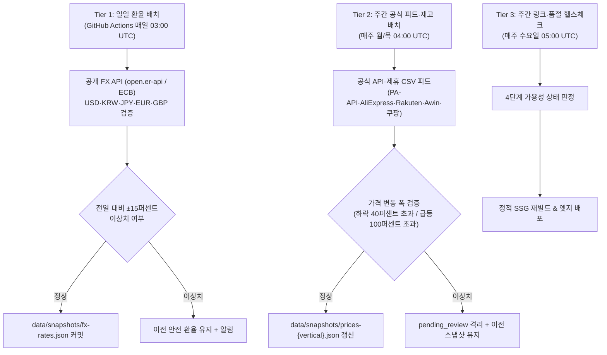

# 04. 글로벌 수익화 아키텍처, 자동 가격·링크 운영 및 Anti-Spam SEO 방어 체계

> **문서 목적**: `ssalmeok-empire`에 이미 구축·연동된 수익화 코드를 Day 0부터 무중단 승계하고, 5개국어(EN/KO/JA/DE/ES) 글로벌 제휴 네트워크 확장, 자동 가격·환율·품절 스냅샷 및 죽은 링크 자동 대체 규칙, 그리고 구글 Scaled Content Abuse·색인 블로트 원천 방어 체계를 실전 운영 수준으로 설계한다.

---

## 1. 기존 `ssalmeok-empire` 수익 자산 즉시 연동 (Day 0 상속)

`C:\Users\kbu39\.gemini\antigravity\scratch\ssalmeok-empire\deploy-ops\monetization-config.json`에 저장된 기존 수익 코드와 검색엔진 인증 토큰을 `specmatrix-global` 빌드 환경변수(`.env.production.local`)에 그대로 상속하여 **런칭 1일차부터 광고·제휴 수익이 즉시 발생**하도록 구성한다.

| 수익·운영 채널 | 기존 확보 코드 (`ssalmeok-empire`) | `specmatrix-global` 즉시 연동 방식 | 확장·고도화 포인트 |
| :--- | :--- | :--- | :--- |
| **구글 애드센스** | `ca-pub-8587506565277191` | `<meta name="google-adsense-account">` + 비동기 스크립트 + 루트 `ads.txt` (`google.com, pub-8587506565277191, DIRECT, f08c47fec0942fa0`) 자동 생성 | 독립 커스텀 도메인 연결 즉시 AdSense 사이트 추가 심사 제출 |
| **쿠팡 파트너스 (KR)** | `AF2200875` / Sub-ID `ssalmeok-kr` | `ko` 로케일 1순위 CTA 버튼(`lptag=AF2200875&subId=...`) 자동 조립 | 버티컬별 ROI 추적을 위해 Sub-ID를 `specmatrix-watt`, `specmatrix-pure`, `specmatrix-cycle`, `specmatrix-home`으로 분기(미지정 시 `ssalmeok-kr` 폴백) |
| **아마존 어소시에이트 (US)** | `kbu3986-20` | `en` 로케일 1순위 CTA 및 ASIN/검색 딥링크(`tag=kbu3986-20`) 즉시 적용 | **Amazon OneLink** 마스터 허브로 지정해 JP/DE/ES/UK/CA 스토어 ID 일괄 연동 |
| **아이허브 리워드 (신규 활성화)** | 현재 공란 (`iherbCode: ""`) | `NEXT_PUBLIC_IHERB_CODE` 활성화 즉시 PureGram `en`/`ko`/`ja` 전 페이지 2순위 버튼 점화 | 보충제 수수료 5–10퍼센트로 아마존(1–3퍼센트) 대비 수익성 2–3배 우위 |
| **검색엔진 소유권 인증** | GSC `srNR80vNCy3sBgCrxGn_bZLwTPgwsvqmdTxF4arEhw4` / Naver `8c10763f9e41c812023c31dc42cce3517af9ad25` | `kbu3986.github.io` 파일럿 구간 즉시 재사용 | 독립 커스텀 도메인 전환 시 DNS TXT 레코드 기반 도메인 속성(Domain Property) 신규 등록 |

### Control Tower 확장 규격 (`monetization-config.v2.json`)

기존 1-Click GUI(`딸깍_수익화_세팅기.cmd` · `deploy-ops/control-tower/server.mjs`)를 5개국어·멀티제휴 대응 `v2` 설정 포맷으로 승격해 코드 수정 없이 전 버티컬 수익 ID를 일괄 배포한다.

```json
{
  "schemaVersion": "2.0",
  "adsenseId": "ca-pub-8587506565277191",
  "coupang": {
    "partnersId": "AF2200875",
    "defaultSubId": "ssalmeok-kr",
    "verticalSubIds": {
      "wattcheck": "sm-watt-kr",
      "puregram": "sm-pure-kr",
      "cyclegear": "sm-cycle-kr",
      "hometech": "sm-home-kr"
    }
  },
  "amazonOneLink": {
    "us": "kbu3986-20",
    "jp": "specmatrix-jp-22",
    "de": "specmatrix-de-21",
    "es": "specmatrix-es-21",
    "uk": "specmatrix-uk-21",
    "ca": "specmatrix-ca-20"
  },
  "globalAffiliates": {
    "iherbCode": "PENDING_FILL",
    "aliexpressTrackingId": "PENDING_FILL",
    "rakutenAffiliateId": "PENDING_FILL",
    "awinPublisherId": "PENDING_FILL",
    "impactAccountSid": "PENDING_FILL"
  },
  "releaseGate": {
    "releaseWaveMax": 1,
    "maxPublishedPages": 200
  }
}
```

---

## 2. 5개국어 글로벌 제휴 확장 전략 (Amazon OneLink & 리전별 고수익 파트너)

단일 미국 아마존 태그(`kbu3986-20`)만 유지하면 일본·독일·스페인·영국 방문자 클릭의 **60–80퍼센트가 국제 배송비·관세 장벽으로 이탈**한다. 로케일 및 버티컬별로 현지 지배적 커머스 플랫폼과 고수수료 직영 제휴망을 2중·3중으로 결합한다.

### 2.1 Amazon OneLink 6대 스토어 통합 로드맵

| 우선순위 | 아마존 리전 | 타깃 로케일 | 예상 수수료율 (전자/스포츠/보충제) | 가입·정산 실무 포인트 |
| :--- | :--- | :--- | :--- | :--- |
| **0순위 (완료)** | **Amazon US** (`amazon.com`) | `en` (미국·글로벌) | 1–4.5퍼센트 | `kbu3986-20` 가동 중, W-8BEN(한미 조세조약 원천징수 0퍼센트) 유지 |
| **1순위** | **Amazon JP** (`amazon.co.jp`) | `ja` (일본) | 2–8퍼센트 (최대 상한 1,000 JPY/건) | 한국 거주자 가입 가능, Payoneer/Wise 엔화 계좌 수령 후 US OneLink 연결 |
| **2순위** | **Amazon DE** (`amazon.de`) | `de` (독일·오스트리아·스위스) | 1–7퍼센트 (CycleGear·HomeTech 고단가) | 유럽 최대 객단가 시장, OneLink 연결 시 DE/AT/CH 영문·독문 방문자 자동 라우팅 |
| **3순위** | **Amazon ES** (`amazon.es`) | `es` (스페인·유럽 스페인어권) | 1–7퍼센트 | 독일 계정과 동일 유럽 OneLink 그룹 통합 관리 |
| **4순위** | **Amazon UK / CA** (`co.uk` / `.ca`) | `en` (영국·캐나다 방문자) | 1–6퍼센트 | `en` 페이지 트래픽 중 비미국권(약 20–30퍼센트) 수익 누수 차단 |

> [!TIP]
> **Amazon API 자격 및 정책 주의**: Amazon PA-API 5.0 / Creators API는 최근 30일 내 적격 판매 3건 이상 등 운영 자격을 요구한다. 초기에는 **로케일별 도메인 분기 딥링크 + OneLink 스크립트**로 100퍼센트 정상 수익화를 선행하고, 판매 실적 확보 후 공식 API 배치로 업그레이드한다.

### 2.2 로케일 × 버티컬 멀티 제휴 라우팅 매트릭스

아마존 전자기기 수수료(1–3퍼센트)의 한계를 돌파하기 위해 **버티컬별 2순위·3순위 고수수료 파트너**를 모든 제품 카드에 병렬 배치한다.

| 로케일 | 1순위 메인 스토어 | 2순위 고수수료 특화 스토어 (버티컬별) | 3순위 글로벌·직구 보완망 | 기대 수수료율 범위 |
| :--- | :--- | :--- | :--- | :--- |
| **`en` (US/UK/CA)** | Amazon OneLink (`kbu3986-20`) | PureGram: **iHerb**(5–10퍼센트) / CycleGear: **AvantLink·Impact**(Competitive Cyclist·Jenson USA·COROS·Wahoo 5–8퍼센트) / HomeTech: **Anker·Roborock·Beelink 직영몰**(Impact/CJ 4–8퍼센트) | **AliExpress Portals** (Magene·Cuktech·MiniPC 등 3–9퍼센트) | **3–10퍼센트** |
| **`ko` (KR)** | **쿠팡 파트너스** (`AF2200875`) | PureGram: **iHerb KR**(5–10퍼센트) / CycleGear·HomeTech: **AliExpress Portals KR**(파워미터·카본·MiniPC 초고전환 3–9퍼센트) | Amazon US 직구 (`kbu3986-20`), 쿠팡 로켓직구 특가 | **3–9퍼센트** |
| **`ja` (JP)** | **Amazon JP** (OneLink) | **Rakuten Affiliate**(라쿠텐 2–4퍼센트, 일본 내 보충제·가전·자전거 최고 신뢰도) + **iHerb JP**(5–10퍼센트) | **ValueCommerce**(Yahoo! Shopping), AliExpress JP | **2–10퍼센트** |
| **`de` (DACH)** | **Amazon DE** (OneLink) | **Awin / TradeTracker**(Bike24·Bike-Components·Rose Bikes·ESN·Mindfactory·Galaxus 3–8퍼센트) | AliExpress DE, 브랜드 EU 공식몰 | **3–8퍼센트** |
| **`es` (ES/LATAM)** | **Amazon ES** (OneLink) | **Awin / TradeDoubler**(Deporvillage·Tradeinn/Bikeinn·PcComponentes·HSNstore 4–8퍼센트) | AliExpress ES (스페인어권 점유율 최상위 3–9퍼센트) | **3–9퍼센트** |

### 2.3 3단계 수익 레이어 및 버티컬별 기대 단가 (RPM × 제휴 EPC)

| 버티컬 | 평균 객단가(AOV) | 애드센스 예상 RPM (5개국 가중) | 제휴 예상 클릭당 수익(EPC) | 핵심 수익 드라이버 |
| :--- | :--- | :--- | :--- | :--- |
| **1. WattCheck Matrix** | 8만 원 (60 USD) | 6–14 USD | 0.12–0.28 USD | 여행 시즌(5–8월·12–2월) 폭발적 검색량 + 절연 파우치·케이블 묶음 전환 |
| **2. PureGram Matrix** | 6만 원 (45 USD) | 5–12 USD | 0.15–0.35 USD | iHerb·쿠팡 정기 재구매 + 1:1 VS 페이지 초고클릭률(CTR 12–20퍼센트) |
| **3. CycleGear Matrix** | **85만 원 (620 USD)** | **12–26 USD** | **0.60–1.80 USD** | 50만–200만 원 고단가 파워미터·스마트 트레이너·GPS 컴퓨터 단건 고액 수수료 |
| **4. HomeTech TCO Matrix** | **65만 원 (480 USD)** | **14–30 USD** | **0.45–1.30 USD** | B2B/홈서버·가전 고CPC 광고 단가 + 독일·일본·미국 고단가 NAS/로봇청소기 전환 |

### 2.4 5개국 법적 제휴 고지문(Compliance-by-Design) 자동 삽입

모든 제휴 CTA 영역 상단·하단에 로케일별 법정 필수 문구와 `rel="sponsored nofollow noopener"` 속성을 컴포넌트 차원에서 강제한다.

| 로케일 | 적용 법령·규정 | 자동 노출 필수 고지 문구 요약 |
| :--- | :--- | :--- |
| `en` | 미국 FTC Endorsement Guides & Amazon Operating Agreement | `"As an Amazon Associate and affiliate partner, SpecMatrix earns from qualifying purchases at no extra cost to you."` |
| `ko` | 공정거래위원회 추천·보증 심사지침 & 쿠팡 파트너스 약관 | `"이 페이지는 쿠팡 파트너스 및 글로벌 제휴 활동의 일환으로, 이에 따른 일정액의 수수료를 제공받습니다."` |
| `ja` | 일본 경품표시법(스테마 규제, 2023년 10월 시행) | 페이지 최상단 배지 **`[PR / アフィリエイト広告]`** 고정 노출 + Amazon 어소시에이트 문구 병기 |
| `de` | 독일 부정경쟁방지법(UWG) 및 텔레미디어법(DDG/TMG) | 링크 옆 **`*`** 표기 및 상단 **`"Werbung / Affiliate-Links (*): Bei Kauf über gekennzeichnete Links erhalten wir eine Provision."`** |
| `es` | 스페인 전자상거래법(LSSI-CE) | `"Aviso de afiliados: Como Afiliado de Amazon y socios comerciales, SpecMatrix obtiene ingresos por compras adscritas."` |

---

## 3. 자동 가격·품절 갱신(스냅샷 배치) 및 죽은 링크 자동 대체 규칙

기존 `ssalmeok-empire/site3-puregram/scripts/update-prices.mjs`의 무인 환율·스냅샷 구조를 4대 버티컬·5개 통화 대응 **3-Tier 배치 파이프라인**으로 확장한다.

> [!CAUTION]
> **정책·컴플라이언스 절대 원칙**: 아마존·쿠팡·유통사 웹페이지 무단 HTML 스크래핑, 봇 탐지·CAPTCHA 우회, API 미승인 상태의 실시간 가격 위조 표기는 계정 영구 정지 사유이므로 **전면 금지**한다. 오직 공식 허가 API(Amazon PA-API/Creators API, 쿠팡 파트너스 오픈 API, AliExpress Portals API, Rakuten Item Search API, Awin/CJ 제품 피드, 공개 환율 API)와 제조사 공식 출고가(MSRP)만 사용한다.

### 3.1 3-Tier 스냅샷 갱신 아키텍처



| 배치 티어 | 실행 주기 | 수집 대상 | 안전 가드레일 (Guardrail) | 초기(API 승인 전) 폴백 전략 |
| :--- | :--- | :--- | :--- | :--- |
| **Tier 1 (환율)** | 매일 1회 (UTC 03:00) | USD/KRW/JPY/EUR/GBP 5대 환율 | 전일 대비 ±15퍼센트 초과 급변 시 자동 거부, 타임아웃 4.5초, 오프라인 직전값 폴백 | `open.er-api.com` + ECB 공개 XML 무료 무키 즉시 가동 |
| **Tier 2 (가격·재고)** | 주 2회 (월·목) | 공식 제휴 API·피드 제공 품목의 판매가·재고 유무 | 직전 스냅샷 대비 40퍼센트 초과 급락 또는 100퍼센트 초과 급등 시 `pending_review` 격리 | **제조사 공식 MSRP 참고가 + 기준일 표기** + `"실시간 최저가 확인"` CTA + 사용자 가격 입력 슬라이더 |
| **Tier 3 (링크 헬스)** | 주 1회 (수요일) | 공식 API 상태 코드 및 `citations` 공식 스펙 URL 응답 | 1회 실패만으로 삭제하지 않고 **2주 연속(2회 이상) 실패** 시에만 상태 강등 | `scripts/check-affiliate-health.mjs` 자동 리포트 생성 |

### 3.2 죽은 링크·품절·단종 4단계 자동 대체 규칙 (Fallback Cascade State Machine)

제품이 품절되거나 단종되어도 **기존 URL을 404로 삭제하지 않는다**. 축적된 검색 유입과 백링크를 보존하면서 클릭 수익 손실을 0퍼센트에 가깝게 방어하는 자동 치환 규칙을 적용한다.

| 상태 코드 | 판정 조건 | UI / CTA 자동 동작 | 수익 링크 폴백 규칙 | SEO 처리 |
| :--- | :--- | :--- | :--- | :--- |
| **`IN_STOCK`** | 공식 피드 재고 확인 또는 정상 판매 중 | 기본 1·2·3순위 구매 버튼 정상 노출 + 확인 일자(`YYYY-MM-DD`) 표기 | ASIN/상품 직링크 우선, 미확보 시 정밀 검색 딥링크 | 정상 색인(`index, follow`) |
| **`OUT_OF_STOCK_TEMP`** | 1순위 스토어 일시 품절 (14일 미만) | 1순위 버튼에 `"일시 품절 가능 — 재고 확인"` 배지 부착, **2순위 재고 보유 스토어를 1순위로 자동 승격** | 예: Amazon US 품절 → iHerb 또는 AliExpress / 직영몰 1순위 노출 | 정상 색인 유지 |
| **`DISCONTINUED_OR_404`** | 제조사 단종 확인 또는 **14일 이상 연속 404/품절** | 페이지 최상단에 **단종 안내 배너** 노출 + JSON `successor_slug` 또는 동일 스펙 클러스터 최상위 가용 제품 2종(`auto_fallback_slugs`)을 **"동급·후속 추천 모델" 카드**로 즉시 대체 | 죽은 상품 직링크를 자동 비활성화하고 **`buildSearchFallbackUrl(brand + category + keySpec)`** 안전 검색 딥링크로 소프트 강등 | **절대 404 삭제 금지**, 단종 모델 검색 트래픽을 후속 모델로 자연 전환 |
| **`PRICE_STALE`** | 스냅샷 최종 확인 후 **30일 초과 미갱신** | 단가 옆에 `"참고가 기준일 경과"` 툴팁 자동 표시 + 랭킹표 계산기에서 사용자 직접 가격 입력 유도 | 링크는 유지하되 월간 재검증 큐에 자동 등록 | 정상 색인 유지(허위 실시간 가격 표기 방지) |

---

## 4. 구글 Scaled Content Abuse 및 색인 블로트(Index Bloat) 5중 방어 체계

대규모 토큰으로 수천–수만 페이지를 생성할 때 가장 치명적인 리스크는 구글의 **Scaled Content Abuse(대량 저품질 생성 스팸 정책)** 및 **크롤링 예산 고갈(발견됨/크롤링됨 - 현재 색인 생성되지 않음)**이다. 이를 배포·도메인·모니터링·UX·스키마 5중 방어막으로 차단한다.

### 4.1 방어막 1: Drip-Feed 점진 배포 스케줄 및 Circuit Breaker

런칭 첫날 수천 페이지를 일괄 투하하지 않는다. 모든 제품·비교 JSON에 `release_wave` 번호를 부여하고, 빌드 환경변수 `RELEASE_WAVE_MAX` 및 `MAX_PUBLISHED_PAGES`로 배포 수량을 코드 차원에서 강제 제어한다.

| 배포 단계 | 목표 누적 페이지 | 포함 범위 | 다음 단계 진행 게이트 (필수 통과 조건) | 미달 시 대응 (Circuit Breaker) |
| :--- | :--- | :--- | :--- | :--- |
| **1주차 (Pilot)** | **200p** | WattCheck·PureGram 최상위 앵커 40종 × 5개국어 | GSC 색인율 **80퍼센트 이상**, Soft 404·중복 판정 5퍼센트 미만, CWV 통과 | 배포 동결 → 템플릿·인터랙티브 비중·`hreflang` 전면 수정 |
| **2주차 (Scale 1)** | **1,000p** | Wave 1 핵심 제품 120종 + 1:1 핵심 VS 60쌍 + 항공사 20개 × 5개국어 | GSC 색인율 **75퍼센트 이상**, 초기 노출(Impressions) 5개국 중 3개국 이상 발생 | 비색인 URL 패턴 분석(언어/유형별) 후 저품질 조합 제외 |
| **4주차 (Scale 2)** | **5,000p** | Wave 1 코어 완성 + Wave 2(CycleGear 앵커 80종) 투입 | GSC 색인율 **70퍼센트 이상**, `크롤링됨 - 현재 색인 생성되지 않음` 비율 20퍼센트 미만 | 1:1 VS 확장 일시 정지, 개별 제품 및 허브 정보밀도 보강 |
| **8–12주차 (Core)** | **15,050p** | 4대 버티컬 1,950종 코어 완성 (Wave 1–3 전량) | 색인율 **65퍼센트 이상** 유지 시 선별적으로 2차 VS 확장(최대 29,550p) | **색인율 50퍼센트 미만 하락 시 즉각 신규 발행 중단 + 하위 20퍼센트 가지치기** |

### 4.2 방어막 2: 독립 커스텀 도메인 전환 전략 (GitHub Pages → 전용 브랜드 도메인)

기존 `kbu3986.github.io` 서브패스는 무료 검증용으로는 훌륭하지만, 5개국어 15,000페이지 규모에서는 공유 도메인 권위 한계·서브패스 간 크롤링 경쟁·애드센스 루트 의존성·브랜드 신뢰도(E-E-A-T) 제약이 명확하다.

| 단계 | 호스팅·도메인 구성 | 권장 시점 | 핵심 목적 및 전략 |
| :--- | :--- | :--- | :--- |
| **Stage 0 (기술 검증)** | Cloudflare Pages 프리뷰 (`*.pages.dev`) 또는 `kbu3986.github.io/specmatrix-global` (`noindex` 스테이징) | Day 1–7 | 5개국어 빌드 속도·JSON 스키마·인터랙티브 계산기·CWV 점검 (Cloudflare Pages는 무료 플랜에서도 무제한 대역폭·전 세계 엣지 캐시 제공) |
| **Stage 1 (본격 배포)** | **단일 마스터 커스텀 도메인** (연 10–15 USD, 예: `specmatrix.io` / `specmatrix.org`) + Cloudflare DNS/Pages | 1주차 Drip-Feed 200p 개시 직전 | **4개 버티컬을 개별 도메인으로 쪼개지 않고 단일 마스터 도메인 + 서브디렉토리(`/{locale}/{vertical}/...`)로 통합**하여 도메인 권위(DR), 백링크, 애드센스 심사(1회 통과), GSC 관리를 집중 |
| **Stage 2 (기존 자산 공존)** | 기존 `ssalmeok-empire` 3개 사이트(`wattcheck-global`, `worthmove-global`, `puregram-global`) **병행 유지** | 상시 | 기존 수익 사이트를 성급히 폐쇄하지 않고 운영하면서, `specmatrix` 독립 도메인의 트래픽이 기존 사이트의 3배 이상 안착한 뒤에만 중복 페이지 `rel="canonical"` 또는 301 통합 검토 |

### 4.3 방어막 3: GSC 색인율 주간 모니터링 및 자동 가지치기(Pruning) 규칙

사이트맵을 하나의 거대한 파일로 묶지 않고 **버티컬 × 언어별 분할 사이트맵(총 20개, 파일당 최대 2,000 URL)**과 통합 `sitemap-index.xml`로 분리 제출한다. 예를 들어 `sitemap-cyclegear-de.xml`만 색인율이 떨어졌다면 1분 내에 독일어 CycleGear 템플릿 문제로 원인을 특정할 수 있다.

| GSC 핵심 지표 | 정상(Green) | 경고(Yellow — 원인 점검) | 위험(Red — 배포 즉각 중단) |
| :--- | :--- | :--- | :--- |
| **제출 대비 색인율** | 75퍼센트 이상 | 55–74퍼센트 | **50퍼센트 미만** |
| **`크롤링됨 - 현재 색인 생성되지 않음`** | 15퍼센트 미만 | 15–29퍼센트 | **30퍼센트 이상** (콘텐츠 품질·중복 의심 신호) |
| **`발견됨 - 현재 색인 생성되지 않음`** | 15퍼센트 미만 | 15–30퍼센트 | **30퍼센트 초과** (크롤링 예산 부족·내부링크 단절) |
| **최근 60일 노출 발생 URL 비율** | 40퍼센트 이상 | 20–39퍼센트 | **20퍼센트 미만** (검색 수요 없는 유령 조합 과다) |
| **Core Web Vitals 양호 비율** | 90퍼센트 이상 (LCP 2.5초 미만, CLS 0.05 미만) | 75–89퍼센트 | **75퍼센트 미만** (광고 슬롯 CLS 즉시 수정) |

**60일 무성과 가지치기 규칙**: 배포 후 60일이 경과했는데도 **노출 0회 + 미색인 상태**가 지속되는 1:1 VS 또는 장꼬리 교차 페이지는 사이트맵에서 자동 제거하고 `<meta name="robots" content="noindex, follow">`로 전환한 뒤, 상위 카테고리 인터랙티브 매트릭스로 검색 수요를 흡수시킨다.

### 4.4 방어막 4: 전 페이지 고유 인터랙티브 계산기·필터 및 Information Gain 의무화

구글의 스팸 탐지 시스템은 "키워드만 바꾼 정적 텍스트 반복(Doorway/Scaled Template)"을 가장 먼저 걸러낸다. `specmatrix-global`은 **인터랙티브 도구가 없는 순수 텍스트 페이지 발행을 원천 금지**한다.

| 페이지 유형 | 의무 탑재 인터랙티브 모듈 | 고유 정보 이득(Information Gain) 강제 항목 |
| :--- | :--- | :--- |
| **개별 제품 상세** | **실시간 사용자 입력 계산기** (WattCheck: 내 기기 완충 횟수·항공사 즉시 조회 / PureGram: 내 구매가 입력 필러세 / CycleGear: 내 프레임 BB 호환 체커 / HomeTech: 내 전기요금제 3년 TCO 슬라이더) | 제조사 스펙시트 출처 링크 최소 2개 + 국가별 실무 함정(`local_gotchas`) + 동급 대체품 3종 실시간 필터 표 |
| **1:1 VS 비교** | **우선순위 가중치 승패 시뮬레이터** (가성비·경량·저소음·내구성 토글 시 추천 승자 실시간 재계산) + 항목별 수치 격차(Delta) 하이라이트 | 단순 스펙 나열 금지 — **수치 기반 승패 사유 + 3년 누적 비용 손익분기점 또는 1 W/1 g당 절감액 계산** 의무화 |
| **카테고리·랭킹 허브** | **다중 패싯 클라이언트 필터 + 다열 정렬 매트릭스 + URL 쿼리 공유** (예산·무게·Wh·순도·소음 dB·인증 필터) | 5개국어별 현지 판매 모델·통화·전기요금 반영으로 언어별 순위 자체가 달라지는 **진짜 현지화 데이터** |

**5개국어 `hreflang` 완벽 상호 참조 규칙**:
- 모든 페이지는 `en`, `ko`, `ja`, `de`, `es` 5개 `<link rel="alternate" hreflang="..." />`와 `x-default`(`en` 지정) 및 자기 참조 `canonical`을 빠짐없이 출력한다.
- 특정 국가에만 존재하는 로컬 제품(예: 한국 전용 쿠팡 PB 프로틴, 일본 전용 PSE 충전기)을 타 로케일에 억지로 빈 페이지로 생성하지 않고, **5개국 중 유통·검색 수요가 존재하는 로케일에만 선택 생성**해 빈 껍데기 페이지(Thin Content)를 방지한다.

### 4.5 방어막 5: 구조화 데이터(JSON-LD) 및 1인 무인 운영 Runbook

#### 자동 삽입 JSON-LD 스키마 규격
- **`Product` + `additionalProperty`**: 정밀 수치 스펙(Wh, 순도, 무게, 소비전력 W, 소음 dB)을 구조화 속성으로 노출. 단, 공식 API 가격 미연동 초기 단계에서는 잘못된 `Offer` 가격 경고를 피하기 위해 `TechArticle` / `Dataset` / `Product`(가격은 공식 피드 연동 항목에 한해 `Offer` 활성화)로 안전 운영한다.
- **`WebApplication`**: 모든 버티컬 계산기·시뮬레이터에 적용해 도구형 검색 의도 신호 강화.
- **`ItemList`**: 카테고리 랭킹 리더보드 상위 10–20개 항목 구조화.
- **`FAQPage` + `BreadcrumbList`**: 국가별 규정·호환성 핵심 Q&A 3–5개를 모든 상세·VS 페이지 하단에 삽입해 구글 AI Overview 인용 확률을 극대화한다.

#### 1인 운영 주간·월간 최소 공수 Runbook (주 15분 + 월 1시간)

| 주기 | 소요 시간 | 점검 항목 | 자동화 여부 및 액션 |
| :--- | :--- | :--- | :--- |
| **일간** | 0분 (무인) | Tier 1 환율 배치 + 배포 상태 확인 | GitHub Actions 실패 시에만 이메일/텔레그램 알림 수신 |
| **주간 (월요일)** | 15분 | 1) GSC 분할 사이트맵 색인율 체크 2) Tier 3 죽은 링크·품절 리포트 확인 3) 애드센스·쿠팡·아마존·iHerb 클릭/CTR 점검 | 게이트 통과 시 `RELEASE_WAVE_MAX` 1단계 상향, `pending_review` 가격 이상치 2–3건 승인 |
| **월간 (매월 1일)** | 60분 | 1) 60일 무노출·미색인 URL 가지치기 실행 2) 고전환 상위 20개 페이지 CTA·제휴 버튼 A/B 개선 3) 신제품 시드(월 50–100종) 토큰 파이프라인 투입 | `cyclegear`·`wattcheck` 신제품 출시(예: 신형 Edge/COROS, 신형 Anker/UGREEN) 우선 반영으로 퍼스트 무버 트래픽 선점 |
