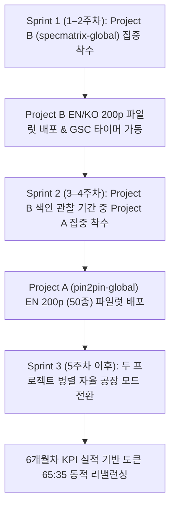

# 05. Risk, Cross-Audit, KPI & Dual-Project Execution Plan — SpecMatrix Global

> **감사 대상**: `README.md`, `01-MASTER-PLAN.md`, `02-TOKEN-BURN-PIPELINE.md`, `03-VERTICAL-ROADMAP.md`, `04-MONETIZATION-AND-OPS.md` (Project B 기획 문서 5종 전수)  
> **감사 목적**: Project B 착수 전 문서 간 모순·카니발리제이션·글로벌 제휴/세무 장벽·인프라 파일 상한·YMYL/법적 리스크를 선제 해소하고, 현실적 월별 수익 시뮬레이션·Kill/Pivot KPI 기준선·Project A×B 직장인 동시 운영 최적화 전략·Day 1–7 파일럿 실행 체크리스트를 확정한다.

---

## 1. Project B 기획서 5종 정밀 교차감사 결과

Project B 기획서는 기존 `ssalmeok-empire`의 검증된 자산(889p + 수익 코드 3종)을 4대 고수익 버티컬 1,950종 실데이터 공장으로 진화시키는 탄탄한 설계를 갖추고 있다. 그러나 실제 개발·배포·정산 단계에서 즉시 장애나 계정 정지로 이어질 수 있는 **치명적 취약점 6건**과 **문서 간 구현 충돌 5건**이 교차감사에서 적발되었다.

### 1.1 핵심 취약점 및 엣지 케이스 감사 결과 (위험도 순)

| ID | 영역 | 심각도 | 발견된 취약점 및 누락 엣지 케이스 | 필수 보완 대책 (착수 전 반영) |
| :--- | :--- | :--- | :--- | :--- |
| **SM-01** | SEO / 자산 충돌 | **치명 (Critical)** | **기존 `ssalmeok-empire` 889p와의 키워드 카니발리제이션 및 1주차 5개국어 분산**: `01-MASTER-PLAN.md`는 기존 `site1-wattcheck`(32항공사)과 `site3-puregram`(48제품)을 신규 도메인으로 흡수하면서 `04-MONETIZATION-AND-OPS.md`는 기존 `kbu3986.github.io`를 병행 유지한다. 동일 제품·동일 규정을 두 도메인에 동시 발행하면 구글이 신생 도메인(`specmatrix.io`)을 복제 사이트(Duplicate Content)로 판정해 색인을 억제한다. 또한 1주차 200p를 5개국어(언어당 40p)로 쪼개면 신생 도메인의 크롤 예산과 주제 권위가 5등분되며, 신규 도메인 애드센스는 심사 기간(2–5주) 동안 수익이 0달러이므로 "런칭 1일차 애드센스 수익" 가정과 충돌한다. | **Phase 1 파일럿(1–4주차)은 기존 `ssalmeok-empire`에 없는 100퍼센트 신규 SKU(에너지젤, 최신 GaN 140–250 W, CycleGear)로만 구성**해 중복을 0퍼센트로 차단한다. 기존 `puregram` 48종은 신규 도메인 권위 확보 후 301/`rel="canonical"`로 일괄 이전한다. 또한 1주차 200p는 5개국어 분산 대신 **EN(100p) + KO(100p) 2개국어**로 집중해 즉시 수익화(아마존 US + 쿠팡)와 색인율 80퍼센트를 먼저 검증한 뒤 3주차부터 JA → DE → ES 순으로 확장한다. |
| **SM-02** | 글로벌 제휴 / 약관 | **치명 (Critical)** | **Amazon Associates 180일 3건 판매 미달 정지, PA-API 차단 및 비승인 가격 표기 위반**: Amazon Associates는 US/JP/DE/ES/UK/CA **리전 계정별로 각각 가입 후 180일 내 적격 판매 3건 미달 시 계정이 영구 폐쇄**된다. 초기부터 6개 스토어를 일괄 가입하면 트래픽이 적은 리전이 줄줄이 정지되며, 최근 30일 판매가 끊기면 PA-API 키도 자동 차단된다. 더욱 치명적인 점은 `03-VERTICAL-ROADMAP.md` 샘플 JSON이 US/JP/DE/ES에 **동일 ASIN을 복붙(예: `B0BYP2F3SG`)하거나 플레이스홀더(`B0F1ASSIOMA`)를 사용**했고, API 미승인 상태에서 고정 MSRP를 아마존 판매가처럼 표기하면 약관 위반으로 계정이 정지된다. | **트래픽 연동 단계적 리전 가입(Staged Regional Signup)**을 의무화한다(해당 언어권 아웃바운드 클릭 월 150건 이상 달성 시점에 Amazon JP → DE → ES → UK/CA 순차 가입). ASIN 직링크는 공식 확인된 리전별 고유 ASIN만 허용하고 미확인 시 안전 검색 딥링크(`buildSearchUrl`)를 기본값으로 강제한다. API 승인 전에는 UI를 **`msrp_benchmark_mode`(공식 출고가 참고 기준 + 사용자 직접 가격 입력 계산기)**로 명확히 분리해 아마존 가격 고정 표기 약관 위반과 가격 괴리 이탈을 동시에 방지한다. |
| **SM-03** | 세무 / 유럽·일본 규제 | **치명 (Critical)** | **일본 Rakuten 정산 장벽, 독일 `Impressum`·EU GDPR CMP 누락**: `04-MONETIZATION-AND-OPS.md`는 일본 2순위 제휴로 Rakuten Affiliate를 지정했으나, 일본 라쿠텐 어필리에이트는 일본 국내 은행 계좌 또는 라쿠텐 캐시 정산 제약이 강해 한국 거주 개인의 직접 현금 정산이 매우 어렵다. 또한 독일(`de`)·스페인(`es`) 상업 사이트는 **독일 디지털서비스법(DDG §5)상 운영자 법적 신원 고지(`Impressum`)**와 **EU EEA/UK 방문자 대상 구글 인증 GDPR 쿠키 동의 배너(CMP)**가 필수이며, CMP 미적용 시 **유럽 트래픽 애드센스 광고 송출이 전면 차단**된다. | 일본 제휴는 **Amazon JP(Payoneer JPY 수령) + iHerb JP + AliExpress JP + Impact/Rakuten Advertising 글로벌** 위주로 재편한다. `de`/`es` 로케일 개방 전 **Google Funding Choices(무료 내장 CMP)**와 `/de/impressum`·`/privacy` GDPR 고지 페이지를 의무 탑재한다. 아울러 리전별 해외 원천소득(Payoneer/Wise 수령) 및 Awin·Impact 세무 서식(W-8BEN 등)을 `ops/tax-compliance-ledger.md`로 분기 관리한다. |
| **SM-04** | 인프라 / 빌드 한계 | **높음 (High)** | **Cloudflare Pages 20,000파일 상한 초과 및 Stage 3 SERP 수집 비용 누락**: `01-MASTER-PLAN.md`는 Next.js 16 Static Export로 15,050–29,550p를 Cloudflare Pages에 배포한다고 설계했으나, Next.js App Router 정적 내보내기는 페이지당 HTML + RSC 페이로드(`.txt`) 등 2–3개 파일을 생성하므로 **15,050p 기준 35,000–45,000개 파일이 발생해 Cloudflare Pages 단일 배포 20,000파일 제한에 걸려 빌드가 100퍼센트 실패**한다. 또한 `02-TOKEN-BURN-PIPELINE.md` Stage 3의 2,000건 × 상위 5개 SERP(= 10,000페이지) 수집은 외부 SERP API 비용과 봇 차단 대책이 누락되어 있다. | ① **Astro 5 순수 HTML SSG**(페이지당 1파일, RSC 오버헤드 0) 또는 **Cloudflare Workers / OpenNext 온디맨드 ISR(R2 JSON 캐시)**로 아키텍처를 전환하거나, 정적 배포 상한을 도메인/버티컬별 15,000파일 이내로 분리한다. ② Stage 3 SERP 감사는 개별 2,000건 전수 수집 대신 **서브카테고리·비교 클러스터 대표 200–250개 핵심 키워드**에 집중(Serper.dev 등 합법 SERP API 저비용 활용)해 클러스터 단위 정보이득 블루프린트를 도출한 뒤 하위 SKU에 상속한다. |
| **SM-05** | 법무 / 안전·YMYL·저작권 | **높음 (High)** | **보충제(YMYL 인접)·기내 규정 변동·후크리스 타이어 안전·유료 계측치 저작권 리스크**: PureGram에서 `"아미노 스파이킹 의혹"` 같은 주관적 표현은 브랜드 명예훼손 및 구글 YMYL(건강) 필터 하락 위험이 있다. WattCheck 100개 항공사는 규정 변경 속도가 빨라 구버전 안내 시 공항 배터리 압수 분쟁 소지가 크다. CycleGear의 **후크리스(Hookless) 림·최대 공기압(5 bar / 72.5 psi) 호환 오판**은 주행 중 타이어 이탈 사고로 직결된다. 또한 `02` Stage 0 Tier 3의 **BicycleRollingResistance(BRR)·ChargerLAB 유료 계측 데이터**를 대량 복제하면 저작권·DB권 침해(DMCA) 위험이 높다. | ① PureGram은 의혹 표현을 삭제하고 **객관적 성분표 팩트(`유리 아미노산 글리신/타우린 원재료명 포함 여부`)**와 가격 수학 계산에만 집중해 YMYL을 회피한다. ② WattCheck 항공사는 **핵심 30개사(월 1회 자동 해시 감시) + 보조 70개사(분기 1회 점검 + 공식 규정 원문 링크 + 최종 확인일 배지)**로 이원화한다. ③ CycleGear 후크리스 항목은 제조사 공식 승인 리스트 재확인 경고 배너를 의무화한다. ④ BRR·ChargerLAB 유료 수치는 전수 복제를 금지하고 공식 제조사 스펙 + 공개 범위 단순 인용(출처 링크)만 허용한다. |
| **SM-06** | 로컬 제품 × 5개국어 팽창 | **중간–높음** | **로컬 전용 제품의 타 로케일 빈 페이지(Thin Content) 및 가격 노후화 이탈**: `04-MONETIZATION-AND-OPS.md`는 로컬 전용 제품(셀렉스·닥터유·SAVAS·ESN·HSN·OMRON UPS)을 유통 국가에만 선택 생성한다고 명시했으나, `03-VERTICAL-ROADMAP.md` 7.1절 페이지 공식은 전체 1,950종에 예외 없이 `× 5개국어`를 곱했다. 독일어·스페인어 페이지에 한국 전용 프로틴을 발행하면 구매 링크도 없고 검색 수요도 없는 유령 페이지가 양산된다. | JSON 공통 규격에 **`available_locales: ["ko"]` 또는 `["en", "ja", "de"]` 화이트리스트**를 강제하고, 실제 1차 코어 목표를 무리한 15,050p 대신 **유효 수요 기반 10,000–12,500p**로 정예화한다. 또한 가격 스냅샷이 14일 이상 경과하면 `"참고가 기준일 경과 — 공식 스토어 실시간 가격 확인"` 툴팁을 자동 표시해 가격 오차로 인한 클릭 이탈을 최소화한다. |

### 1.2 기획서 5종 간 내부 구현 충돌 교차검증표 (Single Source of Truth 확정)

| 충돌 항목 | 문서 간 불일치 내용 | 단일 표준(SSOT) 확정안 |
| :--- | :--- | :--- |
| **URL 패턴 & 버티컬 슬러그** | `01-MASTER-PLAN.md`(`/watt`, `/pure`, `/product/[slug]`, `/rank/[segment]`) vs `03-VERTICAL-ROADMAP.md`(`/wattcheck`, `/puregram`, `/item/[slug]`, `/matrix/...`). | **`/{locale}/{vertical}/{type}/{slug}`로 단일 확정**: 버티컬은 `wattcheck`/`puregram`/`cyclegear`/`hometech`, 아키타입은 `item` / `vs` / `compat` / `matrix`로 통일한다. |
| **JSON 스키마 필드 규격** | `02-TOKEN-BURN-PIPELINE.md` 계약 A(`sku_id`, `rated_wh: {value...}`, `port_matrix`, `certifications: {ul...}`) vs `03-VERTICAL-ROADMAP.md` 샘플(`model_number`, `battery_energy_wh`, `port_allocation_matrix`, `pse_certified`). 또한 `03`의 Synology DS423+ 샘플은 필수 조건인 `citations` 최소 2건을 위반(1건만 기재). | **`03`의 구조화 스키마를 프로덕션 마스터(Zod v2)로 채택**하고, `02`의 `evidence_quote`·`source_tier`는 별도 감사 로그(`data/audit/[sku_id].audit.json`)로 분리해 웹 번들 크기를 경량화한다. `citations` 최소 2건 미만은 빌드 차단한다. |
| **1–2주차 파일럿 물량** | `02`(100종 / 200p → 1,000p) vs `03`(80종 + 30항공사) vs `04`(1주차 40종 × 5언어 = 200p, 2주차 120종 = 1,000p). | **1주차 신규 60종 × EN/KO 2개국어 = 정확히 200p 배포** → 2주차 100종 확장(500p) → 색인율 80퍼센트 확인 후 3주차부터 JA/DE/ES 개방(1,000p+)으로 일원화한다. |
| **쿠팡 Sub-ID 명명 규칙** | `04-MONETIZATION-AND-OPS.md` 1절 표(`specmatrix-watt` 등) vs 1절 JSON(`sm-watt-kr` 등). | 짧은 추적 코드인 **`sm-watt-kr`, `sm-pure-kr`, `sm-cycle-kr`, `sm-home-kr`**(폴백 `ssalmeok-kr`)로 통일한다. |
| **`FAQPage` 리치 스니펫 기대** | `02` Stage 6 및 `04` 4.5절이 `FAQPage` JSON-LD를 핵심 노출 수단으로 명시했으나, 구글은 일반 상업 사이트의 `FAQPage` 리치 결과를 사실상 중단했다. | **`Product`(공식 피드 연동 시 Offer 활성화) + `WebApplication`(계산기) + `ItemList`(랭킹) + `BreadcrumbList`**에 집중하고, FAQ는 구조화 스니펫 기대 대신 본문 가독성·AI Overview 인용용 경량 블록으로만 유지한다. |

---

## 2. 현실적인 월별 수익 시뮬레이션 (3대 시나리오)

Project B는 B2C 구매 직전 트래픽 특성상 **AdBlock 비율이 20–30퍼센트**로 Project A(40–60퍼센트)보다 현저히 낮으며, 기존 `ssalmeok-empire`의 쿠팡(`AF2200875`)·아마존 US(`kbu3986-20`) 코드를 즉시 활용할 수 있어 **1개월차부터 제휴 현금흐름이 개시**된다. 단, 신규 독립 커스텀 도메인의 애드센스 승인 기간(3–5주), 아마존 리전별 180일 3건 판매 단계적 개방, API 승인 전 MSRP 벤치마크 모드 제약을 보수적으로 반영했다.

### 2.1 시나리오별 핵심 전제 조건

| 전제 지표 | 보수적 (Conservative) | 기본 (Base) | 낙관적 (Optimistic) |
| :--- | :--- | :--- | :--- |
| **GSC 색인율 (6개월차)** | 55–65퍼센트 | 75–82퍼센트 | 85–92퍼센트 |
| **언어권 확장 속도** | EN/KO 중심 정체 (JA 지연) | 3개월차 JA, 5개월차 DE/ES 안착 | 3개월차 5개국어 전면 안착 |
| **실효 광고 Net RPM (3→12개월차)** | 3.5 → 6.0달러 | 5.6 → 10.5달러 | 8.0 → 15.0달러 (프리미엄 광고망) |
| **통합 제휴 eRPM (1→12개월차)** | 5.0 → 6.0달러 | 5.0 → 12.0달러 (CycleGear·iHerb 효과) | 8.0 → 18.0달러 (고단가·유럽 Awin) |
| **애드센스 승인 시점** | 2개월차 중순 (1개월차 0달러) | 2개월차 초 (1개월차 0달러) | 1개월차 3주차 조기 승인 |

### 2.2 시나리오별 월간 트래픽 및 수익 상세 (단위: 달러, 환율 1달러 = 1,400원 기준)

#### A. 보수적 시나리오 (색인 지연, EN/KO 위주 정체, 글로벌 제휴 개방 지연)

| 시점 | 월 페이지뷰 (PV) | 실효 광고 RPM | 애드센스 수익 | 국내 제휴 (쿠팡·iHerb KR) | 글로벌 제휴 (아마존·Ali·iHerb) | 월 총매출 (달러) | 월 총매출 (원화 환산) |
| :--- | :---: | :---: | :---: | :---: | :---: | :---: | :---: |
| **1개월차** | 3,000 | 0달러 (심사 대기) | 0달러 | 10달러 | 5달러 | **15달러** | 약 2.1만 원 |
| **3개월차** | 18,000 | 3.5달러 | 63달러 | 45달러 | 27달러 | **135달러** | 약 18.9만 원 |
| **6개월차** | 55,000 | 4.8달러 | 264달러 | 143달러 | 132달러 | **539달러** | 약 75.5만 원 |
| **12개월차** | 120,000 | 6.0달러 | 720달러 | 300달러 | 420달러 | **1,440달러** | 약 201.6만 원 |

#### B. 기본 시나리오 (Drip-Feed 정상 안착, 5개국어 단계 확장, CycleGear·HomeTech 본격 가동)

| 시점 | 월 페이지뷰 (PV) | 실효 광고 RPM | 애드센스 수익 | 국내 제휴 (쿠팡·iHerb KR) | 글로벌 제휴 (OneLink·iHerb·Awin·Ali) | 월 총매출 (달러) | 월 총매출 (원화 환산) |
| :--- | :---: | :---: | :---: | :---: | :---: | :---: | :---: |
| **1개월차** | 8,000 | 0달러 (심사 대기) | 0달러 | 28달러 | 12달러 | **40달러** | 약 5.6만 원 |
| **3개월차** | 45,000 | 5.6달러 | 252달러 | 135달러 | 180달러 | **567달러** | 약 79.4만 원 |
| **6개월차** | 140,000 | 8.0달러 | 1,120달러 | 420달러 | 910달러 | **2,450달러** | 약 343.0만 원 |
| **12개월차** | 350,000 | 10.5달러 | 3,675달러 | 1,050달러 | 3,150달러 | **7,875달러** | 약 1,102.5만 원 |

#### C. 낙관적 시나리오 (5개국어 고속 랭킹, CycleGear·독일 HomeTech 고전환, 프리미엄 광고망 승격)

| 시점 | 월 페이지뷰 (PV) | 실효 광고 RPM | 애드센스 수익 | 국내 제휴 (쿠팡·iHerb KR) | 글로벌 제휴 (OneLink·iHerb·Awin·Impact) | 월 총매출 (달러) | 월 총매출 (원화 환산) |
| :--- | :---: | :---: | :---: | :---: | :---: | :---: | :---: |
| **1개월차** | 20,000 | 2.5달러 (3주차 승인) | 50달러 | 80달러 | 80달러 | **210달러** | 약 29.4만 원 |
| **3개월차** | 110,000 | 8.0달러 | 880달러 | 440달러 | 770달러 | **2,090달러** | 약 292.6만 원 |
| **6개월차** | 350,000 | 12.0달러 | 4,200달러 | 1,400달러 | 3,850달러 | **9,450달러** | 약 1,323.0만 원 |
| **12개월차** | 800,000 | 15.0달러 | 12,000달러 | 2,800달러 | 11,600달러 | **26,400달러** | 약 3,696.0만 원 |

### 2.3 추가 현금 운영비 및 손익분기점

- **월 추가 현금 지출**: 커스텀 도메인 월 환산 1.25달러(연 15달러) + Cloudflare Pages/Workers 무료–5달러 + 클러스터 SERP API 월 10–15달러 = **월 16–22달러 수준**.
- **손익분기점**: 기본 시나리오 기준 **1개월차 말–2개월차 초**에 순 현금 비용을 회수하며, 6개월차에는 **글로벌 제휴(Awin/Amazon OneLink/iHerb)와 국내 쿠팡이 전체 매출의 54퍼센트**를 차지해 광고 알고리즘 변동에 흔들리지 않는 다중 수익 구조를 완성한다.

---

## 3. 구글 스팸·색인 블로트 Kill/Pivot 게이트 및 핵심 KPI 대시보드

분할 사이트맵(`sitemap-{vertical}-{locale}.xml`, 초기 6개 → 완공 20개)을 기준으로 매주 월요일 15분 점검에서 아래 신호등 판정을 기계적으로 적용한다.

### 3.1 핵심 KPI 대시보드 및 자동 서킷 브레이커 기준표

| KPI 영역 | 측정 지표 | 정상 (Go · 증축 승인) | 주의 (Hold · 보강 루프) | 위험 (Kill / 즉시 중단 & Pivot) | 위험 발동 시 강제 액션 |
| :--- | :--- | :--- | :--- | :--- | :--- |
| **GSC 색인** | **분할 사이트맵별 색인율** (배포 21일 후) | 75퍼센트 이상 | 50–74퍼센트 | **50퍼센트 미만** | **해당 버티컬·로케일 `RELEASE_WAVE_MAX` 동결**. 미색인 URL 30건 분석 후 중복도 높은 `vs` 페이지 `noindex` 처리 및 인터랙티브 모듈 보강. |
| **GSC 스팸 신호** | **`크롤링됨 – 미색인` 비율** | 15퍼센트 미만 | 15–29퍼센트 | **30퍼센트 이상** | Scaled Content Abuse 조기 경보 발동. 1:1 `vs` 생성을 전면 중단하고 제품 상세(`item`) + 랭킹 허브(`matrix`) 중심으로 통합. |
| **검색 수요 적합성** | **60일 경과 노출 발생 URL 비율** | 40퍼센트 이상 | 20–39퍼센트 | **20퍼센트 미만** | 노출 0회·미색인 URL 전량 사이트맵 제거 및 `noindex, follow` 가지치기 실행(크롤 예산 회수). |
| **제휴 전환 건강도** | **아웃바운드 제휴 클릭률(CTR) / 죽은 링크율** | CTR 8퍼센트 이상 / 404 1퍼센트 미만 | CTR 4–7.9퍼센트 / 404 1–3퍼센트 | **CTR 3퍼센트 미만 또는 죽은 링크 5퍼센트 초과** | 상단 승자 요약 카드 CTA 위치 조정, 미확인 ASIN 전량 안전 검색 딥링크로 일괄 치환, Tier 3 링크 헬스체크 긴급 실행. |
| **아마존 계정 보호** | **리전별 신규 계정 적격 판매 진척도** | 가입 90일 내 3건 이상 완료 | 120일 시점 1–2건 | **150일 시점 0건 또는 정책 경고 1건** | 비활성 리전 OneLink 라우팅 임시 해제, 고정가 표기 문구 전수 감사(`msrp_benchmark_mode` 강제). |
| **데이터·로케일 품질** | **Stage 2 격리율 / HITL 5퍼센트 치명 오류** | 격리 10퍼센트 미만 / 치명 오류 0건 | 격리 10–15퍼센트 | **격리 15퍼센트 초과 또는 안전·규정 치명 오류 1건** | 배치 즉시 중단(Circuit Breaker). 특히 WattCheck 항공사 규정·CycleGear 후크리스 규격 오류는 24시간 내 핫픽스. |
| **애드센스 & CWV** | **승인 상태 / EU CMP 작동 / CLS** | 승인 완료, CLS 0.05 미만 | 1회 거절, CLS 0.05–0.1 | **2회 연속 거절, EU 광고 차단, CLS 0.1 초과** | `vs` 페이지 임시 `noindex` 후 심층 실사용 가이드 15편 보강 재신청, Google CMP 재설정, 광고 슬롯 `min-height` 고정. |

### 3.2 6개월차 버티컬별 Go / Pivot / Kill 최종 게이트

- **Go (풀 확장 20,000–25,000p 진행)**: 6개월차 월 PV 10만 이상 AND 전체 색인율 70퍼센트 이상 AND 월 매출 1,500달러 이상.
- **Selective Pivot (승자 버티컬 집중)**: 전체 4개 버티컬 중 **상위 2개 버티컬(예: CycleGear + WattCheck)**만 색인율 75퍼센트·고수익을 기록하고 하위 2개가 50퍼센트 미만이면, 하위 버티컬 신규 증축을 중단하고 상위 2개 버티컬에 월 토큰의 85퍼센트를 재배치한다.
- **Kill (대량 확장 종료)**: 6개월차 월 PV 2만 미만 AND 색인율 45퍼센트 미만 AND 월 매출 250달러 미만 → 추가 대량 생성을 중단하고, 고성과 상위 300개 페이지와 계산기 도구만 유지하는 저비용 자동 운영 모드로 전환한다.

---

## 4. Project A × Project B 동시 병행 운영 최적화 전략 (직장인 맞춤)

직장인 운영자(평일 퇴근 후 1–1.5시간 + 주말 4시간, 주 총 9–11.5시간)가 두 프로젝트를 모두 1일차에 동시 개발하면 컨텍스트 스위칭과 번아웃으로 둘 다 지연된다. **2주 시차 릴레이 착수(Staggered Sprint) + 주간 고정 리듬**이 20배 Ultra 요금제 토큰을 100퍼센트 수익 자산으로 전환하는 최적 해법이다.

### 4.1 2주 시차 릴레이 착수 로드맵 (Sprint 1–3)

- **왜 Project B 선행(1–2주차) → Project A 후속(3–4주차)인가?**
  1. **즉시 현금흐름 & 자산 재활용**: Project B는 기존 `ssalmeok-empire` 스택·수익 코드·운영 제어탑이 준비되어 있어 7일 만에 배포하고 1개월차부터 쿠팡·아마존 제휴 수익과 5개국어 색인 데이터를 쌓기 시작한다.
  2. **구글 색인 대기 유휴시간 100퍼센트 활용**: Project B 1차 파일럿 200p를 배포한 직후 14–21일간은 무리하게 증축하지 않고 GSC 색인율을 관찰해야 하는 기간이다. 정확히 이 2주(3–4주차)를 **Project A (`pin2pin-global`) Dual-Path PDF/Vision 파이프라인 구축 및 파일럿 50종 배포**에 투입하면, 4주차 말 두 프로젝트가 **동시에 구글 색인·애드센스 트랙에 올라탄다**.

### 4.2 직장인 주간 표준 타임테이블 (주 9–11시간 · 번아웃 제로 설계)

핵심 원칙은 **"평일 밤 = 무인 에이전트 배치 트리거 & 15분 스팟 검수"**, **"주말 = 아키텍처·계산기 개발 & KPI 의사결정"**의 완전 분리다.

| 요일 | 투입 시간 | 주 담당 프로젝트 | 구체적 수행 업무 | 20배 Ultra 토큰 야간 배치 작업 |
| :--- | :---: | :---: | :--- | :--- |
| **월요일** | 60분 | **공통 (A + B)** | 두 프로젝트 GSC 분할 사이트맵 색인율·GA4·수익 대시보드 점검(20분) + 이번 주 시드 30–50종 확정 및 공식 URL 투입(40분) | Project B Stage 1–2 병렬 리서치·적대적 팩트체크(30–40종) |
| **화요일** | 60분 | **Project B** | 전날 야간 배치 5퍼센트 스팟 체크(CycleGear·WattCheck 중심) + `QUARANTINED` 2–3건 원인 보정 | Project B Stage 4–5 비교 합성 + 다국어 초현지화·Locale QA |
| **수요일** | 60분 | **Project A** | `pin2pin-global` 신규 반도체 20–30종 공식 제조사 PDF URL 큐 투입 + 전주 독자 오류 제보(`Report Error`) 패치 | Project A Stage 0–2 Dual-Path PDF+Vision 파싱·적대적 감사 |
| **목요일** | 60분 | **Project A** | 전날 파싱된 고위험 핀아웃·정격 샘플 5–8종 현업 HW 육안 검수(치명 오류 0건 게이트) | Project A Stage 3–4 크로스레퍼런스(`vs`/`alt`) 매칭·현지화 |
| **금요일** | 45분 | **공통 (A + B)** | 게이트 통과 배치 Drip-Feed 머지·Cloudflare 배포 확인 + 커뮤니티(도싸/Reddit/EEVblog) 유용 도구 1건 공유 | 경량 배포 QA 및 Tier 3 링크 헬스 리포트 자동 수집 |
| **토요일** | 2.5시간 | **개발·고도화 집중** | 인터랙티브 계산기 신규 모듈, SVG 패키지 추가, BOM SaaS/제휴 CTA 최적화, 60일 무성과 페이지 가지치기 | 주간 최대 규모 배치(신규 카테고리 확장 또는 SERP IG 재감사) |
| **일요일** | 1.5시간 | **회고 & 쿼터 최적화** | 주간 토큰 소진율 확인(Ultra 리셋 주기 대비 잔여 토큰 낭비 방지용 야간 대량 검증 큐 예약) + 완전 휴식 | 잔여 Ultra 토큰 소진용 다국어 품질 2차 재감사 배치 |

### 4.3 20배 Ultra 토큰 월간 배분 및 포트폴리오 합산 기대 수익 (기본 시나리오)

| 구간 | Project A (`pin2pin`) 토큰 비중 | Project B (`specmatrix`) 토큰 비중 | 합산 기대 월 매출 (기본 시나리오) | 포트폴리오 시너지 효과 |
| :--- | :---: | :---: | :---: | :--- |
| **1개월차** | 30퍼센트 (파일럿 50종) | 70퍼센트 (파일럿 + Wave 1) | **50달러** (A 10 + B 40 · 약 7만 원) | Project B 쿠팡·아마존 초기 현금흐름으로 고정비 즉시 회수 |
| **3개월차** | 45퍼센트 (250종 확장) | 55퍼센트 (CycleGear 착수) | **777달러** (A 210 + B 567 · 약 109만 원) | 두 도메인 모두 애드센스 승인 완료 및 초기 색인 안착 |
| **6개월차** | 45퍼센트 (500종 + SaaS) | 55퍼센트 (1,500종 + DE/ES) | **3,790달러** (A 1,340 + B 2,450 · 약 531만 원) | B2B SaaS·CPC + B2C 글로벌 제휴로 알고리즘 리스크 완전 분산 |
| **12개월차** | 실적 연동 35–65퍼센트 | 실적 연동 35–65퍼센트 | **12,175달러** (A 4,300 + B 7,875 · 약 1,705만 원) | 100퍼센트 비중복 키워드·이중 수익 엔진 완성 |

---

## 5. Phase 1 즉시 착수용 Day 1–7 파일럿 실행 체크리스트 (`specmatrix-global`)

카니발리제이션 0퍼센트, Cloudflare 파일 상한 준수, 즉시 수익화(EN/KO 2개국어) 원칙을 모두 반영해 **7일 만에 신규 60종 · 200페이지 파일럿**을 프로덕션에 올리는 최단 경로다.

### 5.1 1주차 파일럿 60종(EN/KO 200p) 정밀 구성

- **신규 SKU 60종** (`ssalmeok-empire` 기존 48종과 중복 0건):
  - **WattCheck 25종**: Anker Prime 27650/20000, UGREEN Nexode Pro 160 W/100 W, Shargeek 170, Cuktech 15/20, CIO NovaPort 등 최신 GaN·보조배터리 + 핵심 항공사 30개 규정
  - **PureGram 20종**: 지구력 에너지젤 10종(Maurten Gel 100/160, SiS Beta Fuel, Precision PF 30, GU Roctane 등) + 글로벌·한국 신규 크레아틴·전해질 10종
  - **CycleGear 선행 15종**: COROS DURA, Garmin Edge 840/1050, Wahoo ROAM V2, Favero Assioma PRO RS-2, Garmin Rally RS200, Magene P505, GP5000 S TR, Vittoria Corsa PRO 등
- **정확한 200페이지 산출**: `item` 60 × 2언어(120p) + `vs` 25쌍 × 2언어(50p) + `matrix`/`compat` 10 × 2언어(20p) + 신뢰·법정 정책 5 × 2언어(10p) = **총 200페이지 (EN 100p + KO 100p)**.

### 5.2 Day 1–7 일자별 상세 실행 체크리스트

| 일차 | 핵심 목표 | 구체적 실행 항목 (Checklist) | 완료 기준 (Definition of Done) |
| :--- | :--- | :--- | :--- |
| **Day 1** | SSOT 규격 확정·도메인·시드 60종 확보 | - [ ] `01`–`04` 충돌 항목 최종 통일: URL(`/{locale}/{vertical}/item|vs|compat|matrix/...`), Zod v2 스키마(`available_locales`, `citations >= 2`, `msrp_benchmark_mode`), 쿠팡 Sub-ID(`sm-*-kr`) - [ ] 독립 커스텀 도메인 구매 및 Cloudflare Pages(Astro 5 SSG 또는 OpenNext/Workers 구조 확정 — 20,000파일 한계 선제 해소) 연결 - [ ] 기존 `ssalmeok-empire`와 0퍼센트 겹치는 신규 60종 공식 제조사 URL·스펙시트 120건+ 확보 | 커스텀 도메인 HTTPS 응답 정상, Zod v2 스키마 단위 테스트 통과, 60종 증빙 URL 목록 완성 |
| **Day 2** | Stage 0–2 파이프라인 구축 & 6종 스모크 | - [ ] 증빙 `SHA-256` 해시 캐시 + 영양성분표·PD 포트 분배표 **300 DPI Vision 병행 추출기** 구현 - [ ] 3대 버티컬 결정론적 물리·수학 검산기(Wh 역산, 매크로 합산, 파워미터/타이어 범위) + 15퍼센트 `QUARANTINE` 서킷 브레이커 구현 - [ ] 버티컬별 대표 2종씩 총 6종으로 Stage 0–2 풀 스모크 테스트 실행 | 6종 모두 물리 검산 100퍼센트 통과, Stage 2 신뢰도 95점 이상, 감사 로그 분리 저장 확인 |
| **Day 3** | 파일럿 60종 병렬 리서치·적대적 감사 | - [ ] 60종(WattCheck 25 + PureGram 20 + CycleGear 15) + 핵심 30항공사 Stage 1–2 병렬 배치 실행 - [ ] 격리(`QUARANTINED`) 항목 재추출(최대 2회) 또는 대체 앵커 SKU 교체로 60종 완결 - [ ] 각 SKU별 공식 확인 ASIN/검색 쿼리 검증(가짜·복붙 ASIN 0건 차단) | 검증 완료 Golden JSON 60종 + 30항공사 DB 완성, `citations` 2건 미만 0건 |
| **Day 4** | 리뷰어 스팟 검수·비교 합성·EN/KO 현지화 | - [ ] 고가치 15종(CycleGear 핵심 모델·최신 GaN 포트 분배표·국토부 규정) 도메인 리뷰어 직접 육안 스팟 검수 - [ ] 대표 15개 클러스터 키워드 SERP IG 감사(Stage 3, 75점 이상) → 1:1 `vs` 25쌍(`slugA < slugB` 정규화) + 매트릭스 10종 합성(Stage 4) - [ ] EN/KO 2개국어 초현지화 및 독립 Locale QA(단위·통화·숫자 변조 0건·법정 고지 검증) 완료 | 스팟 검수 **치명 오류 0건**, 200페이지 분량 다국어 페이로드 Locale QA 100퍼센트 통과 |
| **Day 5** | 통합 SSG 프론트엔드 & 3대 인터랙티브 계산기 | - [ ] 4대 아키타입(`item`, `vs`, `compat`, `matrix`) 단일 템플릿 구현 - [ ] 3대 인터랙티브 계산기 탑재: ① WattCheck 30항공사 즉시 조회 + PD 멀티포트 분배 시뮬레이터, ② PureGram 사용자 구매가 입력 실시간 필러세 계산기(`msrp_benchmark_mode`), ③ CycleGear BB/구동계/헤드유닛 호환 체커 - [ ] 안전·규정 면책 배너(기내 규정·후크리스 최대 공기압·건강 비의학 고지) 전 페이지 고정 배치 | 3대 계산기 경계값 테스트 통과, 모바일 뷰포트 레이아웃·CLS 0.05 이하 확인 |
| **Day 6** | 수익 코드 연동·법정 페이지·Stage 6 빌드 게이트 | - [ ] `monetization-config.v2.json` 연동: 쿠팡(`AF2200875`/버티컬 Sub-ID), 아마존 US(`kbu3986-20`, 미확인 상품은 안전 검색 딥링크), iHerb 코드 신규 발급·연동, `ads.txt` + Google CMP(향후 EU 대비) 준비 - [ ] 신뢰·정책 페이지 5종(`/about`, `/methodology`, `/disclaimer`, `/privacy`, `/contact`) 작성 - [ ] 200p 빌드 + 자동 QA 게이트(`NaN`/`undefined`/깨진 링크/`hreflang` 비대칭 0건) + 분할 사이트맵 6종(`sitemap-{vertical}-{en|ko}.xml`) 생성 | 200p 빌드 에러 0건, QA 게이트 100퍼센트 통과, Lighthouse 성능·SEO 95점 이상 |
| **Day 7** | 프로덕션 배포·GSC 제출·초기 시딩 | - [ ] Cloudflare Pages 커스텀 도메인 프로덕션 배포 및 전수 스모크 체크 - [ ] GSC 도메인 속성(DNS TXT) 등록·분할 사이트맵 6종 제출 + GA4/Clarity 이벤트(계산기 조작·제휴 CTA 클릭) 검증 - [ ] 기존 `ssalmeok-empire` 허브에 신규 심층 매트릭스 크로스링크 3–5건 배치 + 국내(도싸·클리앙)·글로벌(Reddit `r/cycling`, `r/UsbCHardware`) 무료 도구 2건 자연 공유 - [ ] **Day 14 / Day 21 GSC 색인율 게이트(50퍼센트 중단 / 80퍼센트 2차 확장) 및 Project A Sprint 2 착수 일정** 등록 | 200p 라이브 배포 완료, GSC 사이트맵 수집 정상, GA4 제휴 클릭 이벤트 실시간 확인 |
